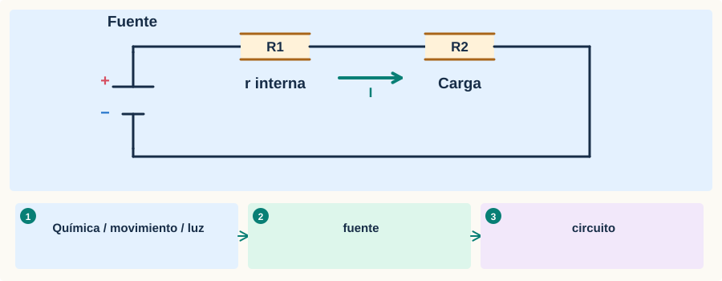

[← Portada](../README.md) · [Índice](../README.md) · [Siguiente →](02.md)

# 01 · Qué hace una fuente

*Diagrama didáctico y secuencia conceptual; no a escala.*

## ¿Qué es y por qué ocurre?

Una fuente mantiene una diferencia de potencial mediante procesos que convierten otra forma de energía. Una pila usa reacciones químicas; un generador usa trabajo mecánico; una celda solar transforma energía radiante. No crea carga ni energía.

## Ejemplo explicado

> Una fuente ideal de 5 V entrega 5 J por C que atraviesa la carga.

## Ahora tú

¿Qué convierte una batería y qué conserva el circuito?

[← Portada](../README.md) · [Índice](../README.md) · [Siguiente →](02.md)
