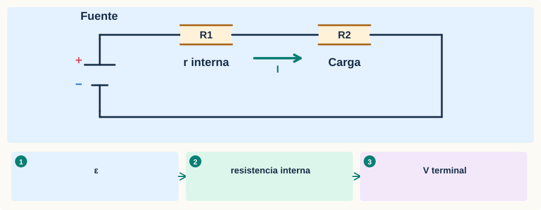
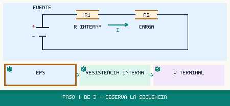

[← Anterior](01.md) · [Índice](../README.md) · [Siguiente →](03.md)

# 02 · Fuente ideal y resistencia interna

*Diagrama didáctico y secuencia conceptual; no a escala.*

## ¿Qué es y por qué ocurre?

Una fuente de tensión ideal mantiene su tensión independientemente de corriente. Una fuente real tiene pérdidas y límites. Modelo básico de descarga: Vterminal=ε−Irint. La fuerza electromotriz ε es energía por carga suministrada por la fuente, no una fuerza mecánica en N.

## Ejemplo explicado

> ε=6 V, rint=1 Ω, I=0,2 A: Vterminal=5,8 V.

## Ahora tú

ε=9 V, rint=2 Ω, I=0,1 A. Calcula Vterminal.

## Secuencia animada

*Se resaltan etapas del diagrama, no se pretende simular el movimiento físico real.*

[← Anterior](01.md) · [Índice](../README.md) · [Siguiente →](03.md)
