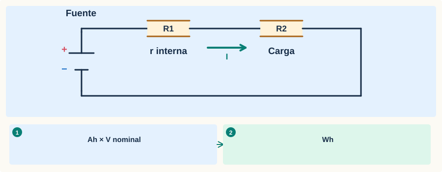

[← Anterior](02.md) · [Índice](../README.md) · [Siguiente →](04.md)

# 03 · Capacidad en Ah y energía en Wh

*Diagrama didáctico y secuencia conceptual; no a escala.*

## ¿Qué es y por qué ocurre?

La capacidad nominal en Ah mide carga: 1 Ah=3600 C. Una batería de 2 Ah podría entregar idealmente 0,2 A durante 10 h, pero la capacidad real depende de tasa, temperatura, edad y corte de tensión. Energía aproximada Wh≈Vnom·Ah; no es garantía exacta.

## Ejemplo explicado

> 3,7 V y 2 Ah: aproximadamente 7,4 Wh, equivalentes a 26,64 kJ.

## Ahora tú

Una batería de 5 Ah a 12 V nominal. ¿Wh aproximados?

[← Anterior](02.md) · [Índice](../README.md) · [Siguiente →](04.md)
