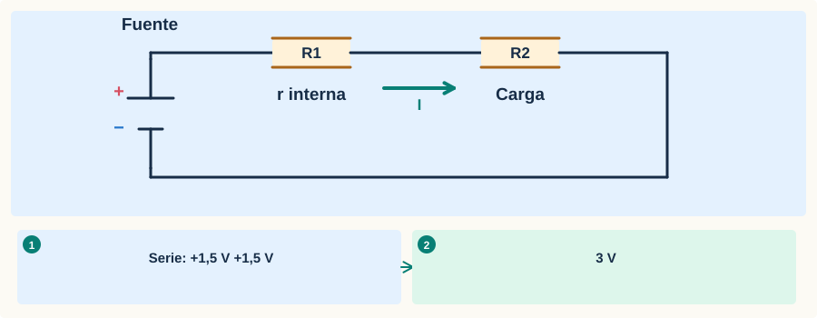

[← Anterior](03.md) · [Índice](../README.md) · [Siguiente →](05.md)

# 04 · Conexiones de fuentes

*Diagrama didáctico y secuencia conceptual; no a escala.*

## ¿Qué es y por qué ocurre?

En un modelo de pilas idénticas compatibles, en serie se suman voltajes con polaridades orientadas correctamente; capacidad Ah ideal se mantiene. En paralelo, tensión igual y capacidad ideal se suma, pero conectar baterías directamente en paralelo exige compatibilidad, protección y diseño específico. No realizar estas conexiones como experimento improvisado.

## Ejemplo explicado

> Dos fuentes ideales de 1,5 V en serie orientadas igual: 3 V.

## Ahora tú

Tres fuentes ideales de 1,5 V en serie: ¿voltaje?

[← Anterior](03.md) · [Índice](../README.md) · [Siguiente →](05.md)
