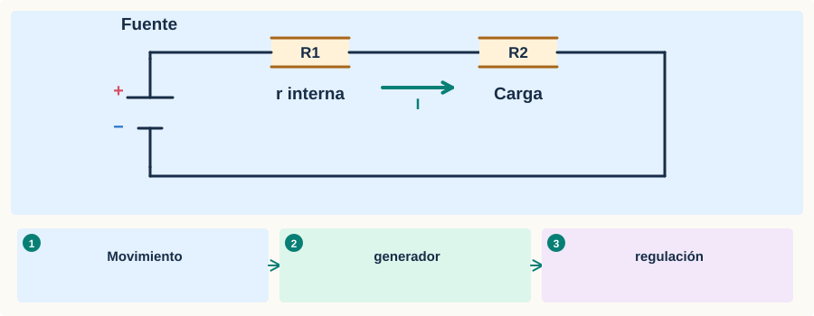

[← Anterior](04.md) · [Índice](../README.md) · [Siguiente →](06.md)

# 05 · Generador y regulación

*Diagrama didáctico y secuencia conceptual; no a escala.*

## ¿Qué es y por qué ocurre?

El movimiento relativo entre imán y bobina puede cambiar flujo magnético e inducir tensión (clase 020). Un regulador mantiene una salida dentro de límites, pero necesita energía y tiene pérdidas. Un cargador no es simplemente una fuente cualquiera: debe seguir especificaciones de la batería.

## Ejemplo explicado

> Un adaptador 5 V 2 A indica salida nominal y límite de corriente, no que siempre entregue 2 A.

## Ahora tú

Si el equipo toma 0,4 A de 5 V, calcula P.

[← Anterior](04.md) · [Índice](../README.md) · [Siguiente →](06.md)
