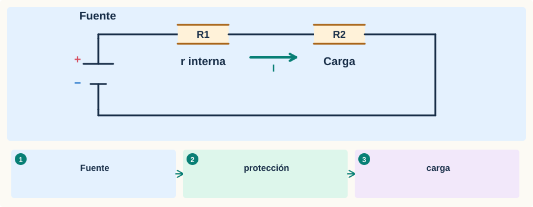

[← Anterior](05.md) · [Índice](../README.md) · [Actividades y cierre →](../descargas.md)

# 06 · Seguridad de fuentes

*Diagrama didáctico y secuencia conceptual; no a escala.*

## ¿Qué es y por qué ocurre?

Una batería puede entregar corriente peligrosa en un cortocircuito aun con bajo voltaje. No unir bornes, no abrir celdas, no mezclar químicas y no cargar pilas no recargables. Para prácticas usar fuente limitada o portapilas adecuado, resistores nominales y supervisión después de clase 013.

## Ejemplo explicado

> Un modelo con ε=3 V y rint=0,1 Ω predice 30 A en corto idealizado; no es una instrucción de prueba.

## Ahora tú

¿Por qué no debes medir corriente conectando amperímetro entre bornes?

[← Anterior](05.md) · [Índice](../README.md) · [Actividades y cierre →](../descargas.md)
