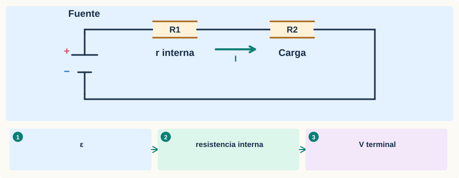

# Práctica guiada · Fuentes de energía: baterías y generadores

**Objetivo:** ¿Por qué cae la tensión de una pila al suministrar corriente?

## Procedimiento

Compara en simulación ε=6 V con rint=0 y 2 Ω y carga de 100 Ω. Calcula I=ε/(R+rint) y Vterminal=IR. Repite con 10 Ω. No pruebes cortocircuitos físicos.

1. Formula hipótesis y dibuja el modelo antes de intervenir.
2. Identifica magnitudes que cambian y las que permanecen fijas.
3. Realiza solo el procedimiento seguro descrito; registra resultados y unidades.
4. Compara con predicción; explica diferencias, incertidumbre y limitaciones.

| Ensayo | Condiciones | Predicción | Observación o cálculo | Explicación |
|---|---|---|---|---|
| 1 | | | | |
| 2 | | | | |
| 3 | | | | |

Rúbrica: predicción 25, registro 25, explicación 40, presentación 10. Seguridad obligatoria. En simulación, los resultados calculados no son evidencia experimental independiente.

[Simulador complementario PhET](https://phet.colorado.edu/es/simulations/circuit-construction-kit-dc) · [Plantilla de informe](../../../../../plantillas/informe-laboratorio.pdf) · [PDF](009-laboratorio.pdf) · [← Índice](../README.md)
