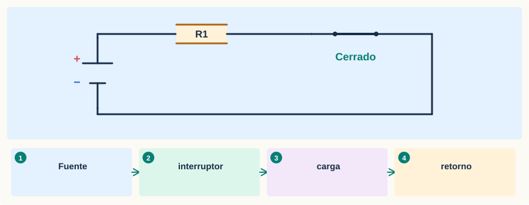
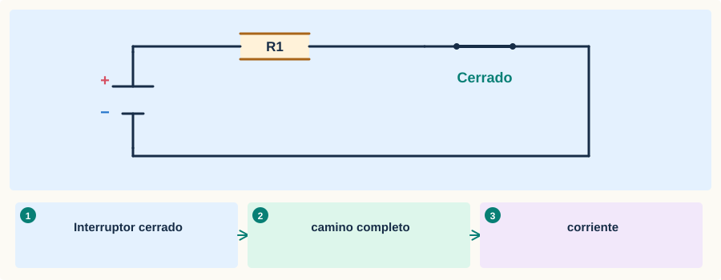
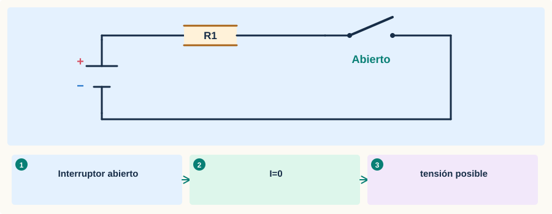
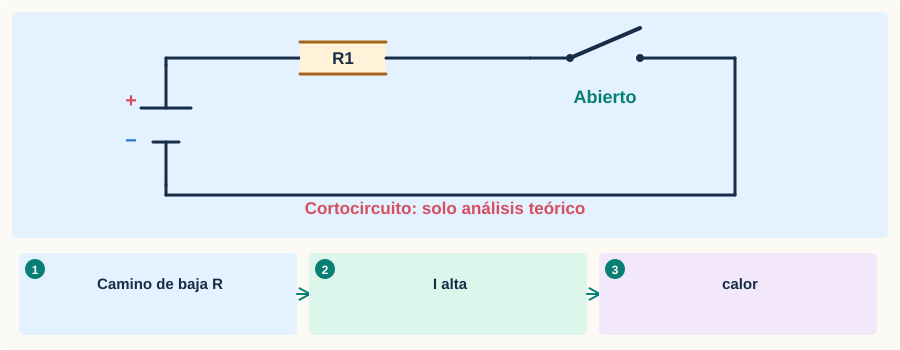
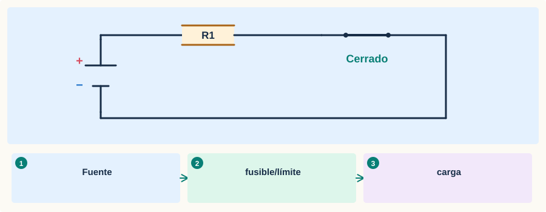
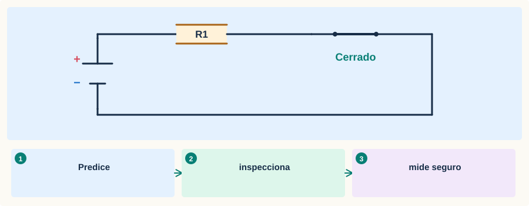

# Cuaderno de ejercicios · Clase 010

[PDF](010-ejercicios.pdf) · [← Índice](../README.md)

## 1. Qué es un circuito

**Ejemplo de estudio:** Una pila, interruptor y resistor forman un lazo si están conectados en serie.

**Resuelve:** ¿Cambiar la forma del dibujo sin cambiar conexiones cambia el circuito ideal?

Escribe datos, procedimiento, unidades (si corresponde), dibujo y justificación. No consultes la solución antes.

## 2. Circuito cerrado

**Ejemplo de estudio:** 6 V y 300 Ω: I=20 mA en modelo ideal.

**Resuelve:** 3 V y 150 Ω en circuito cerrado. ¿I?

Escribe datos, procedimiento, unidades (si corresponde), dibujo y justificación. No consultes la solución antes.

## 3. Circuito abierto

**Ejemplo de estudio:** Si el único lazo se abre, I=0 y una caída de tensión puede aparecer en el interruptor.

**Resuelve:** ¿Un interruptor abierto implica tensión cero entre sus terminales?

Escribe datos, procedimiento, unidades (si corresponde), dibujo y justificación. No consultes la solución antes.

## 4. Cortocircuito

**Ejemplo de estudio:** En el modelo 3 V y 0,5 Ω total, I=6 A; este cálculo muestra el riesgo, no un experimento.

**Resuelve:** ¿Por qué un cable de baja resistencia entre bornes puede ser peligroso?

Escribe datos, procedimiento, unidades (si corresponde), dibujo y justificación. No consultes la solución antes.

## 5. Protección: fusible y límite de corriente

**Ejemplo de estudio:** Una fuente limitada a 50 mA no se comporta como una fuente ideal si se intenta exigir más.

**Resuelve:** ¿Se reemplaza un fusible por alambre para que no se corte?

Escribe datos, procedimiento, unidades (si corresponde), dibujo y justificación. No consultes la solución antes.

## 6. Diagnóstico conceptual

**Ejemplo de estudio:** Si una conexión del único lazo se rompe, no circula corriente sostenida.

**Resuelve:** Da dos causas de circuito abierto.

Escribe datos, procedimiento, unidades (si corresponde), dibujo y justificación. No consultes la solución antes.
