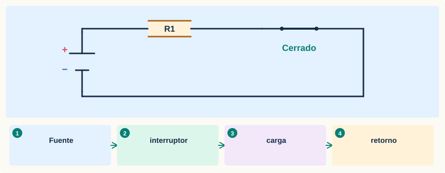
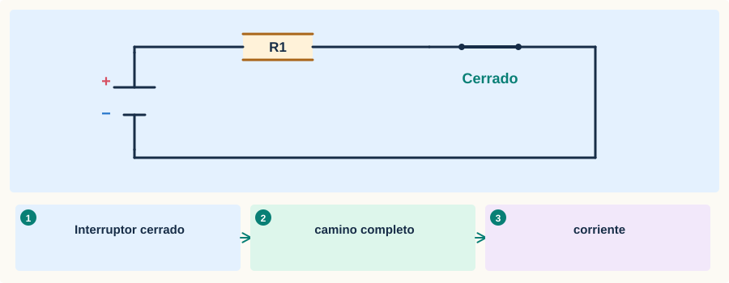
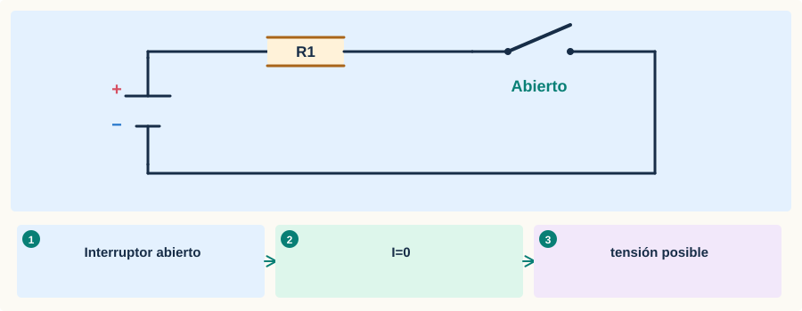
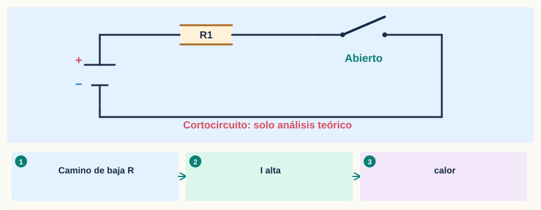
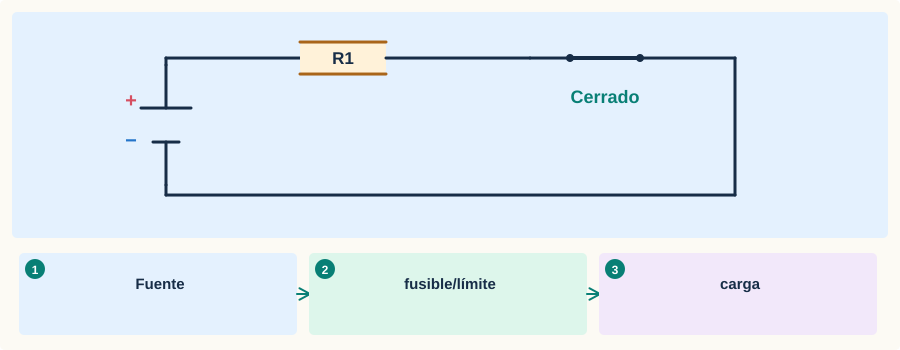
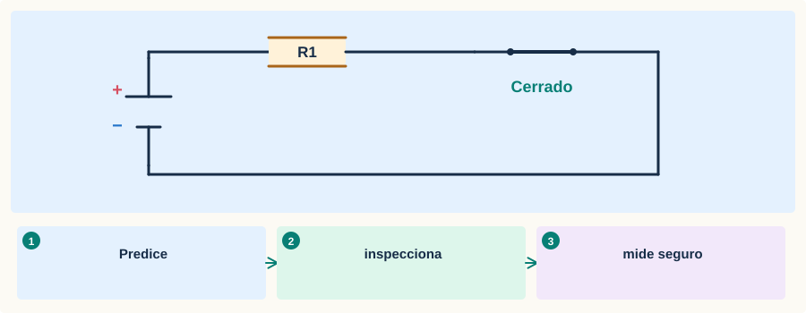

# Circuitos abiertos, cerrados y cortocircuitos

[← Índice](../README.md)

## 01 · Qué es un circuito

Un circuito eléctrico es una red de componentes conectados por caminos conductores. Nodo: conjunto de puntos unidos por conductor ideal; rama: camino entre nodos con elemento(s); lazo: camino cerrado. Un esquema representa conectividad, no ubicación física.

**Ejemplo:** Una pila, interruptor y resistor forman un lazo si están conectados en serie.

**Aplica:** ¿Cambiar la forma del dibujo sin cambiar conexiones cambia el circuito ideal?

---

## 02 · Circuito cerrado

Cuando el interruptor cierra el camino, una fuente puede mantener corriente por la carga. Su valor depende de la resistencia total y limitaciones de la fuente. Cerrar no significa ausencia de resistencia.

**Ejemplo:** 6 V y 300 Ω: I=20 mA en modelo ideal.

**Aplica:** 3 V y 150 Ω en circuito cerrado. ¿I?

---

## 03 · Circuito abierto

Un interruptor abierto interrumpe el camino. En régimen DC ideal, la corriente por ese lazo es cero, aunque pueda haber voltaje entre los contactos. Un voltímetro ideal detecta diferencia de potencial sin establecer una corriente relevante.

**Ejemplo:** Si el único lazo se abre, I=0 y una caída de tensión puede aparecer en el interruptor.

**Aplica:** ¿Un interruptor abierto implica tensión cero entre sus terminales?

---

## 04 · Cortocircuito

Un corto es una conexión no prevista de resistencia muy baja entre puntos con diferencia de potencial. El camino puede evitar la carga prevista. La corriente puede aumentar y calentar conductores, dañar la fuente o provocar incendio. No se prueba físicamente.

**Ejemplo:** En el modelo 3 V y 0,5 Ω total, I=6 A; este cálculo muestra el riesgo, no un experimento.

**Aplica:** ¿Por qué un cable de baja resistencia entre bornes puede ser peligroso?

---

## 05 · Protección: fusible y límite de corriente

Un fusible abre el circuito cuando la corriente y el tiempo superan su característica; protege según diseño y especificación, no garantiza protección contra cualquier contacto. Una fuente limitada reduce corriente al exceder su límite. No puentear fusibles ni reemplazarlos por valores arbitrarios.

**Ejemplo:** Una fuente limitada a 50 mA no se comporta como una fuente ideal si se intenta exigir más.

**Aplica:** ¿Se reemplaza un fusible por alambre para que no se corte?

---

## 06 · Diagnóstico conceptual

Antes de medir, dibuja el camino y predice qué pasa si se abre un contacto, si se cambia una resistencia o si hay puente no previsto. La continuidad se comprobará sin energía en clase 013. Una lámpara apagada puede deberse a varias causas, no solo falta de corriente en la fuente.

**Ejemplo:** Si una conexión del único lazo se rompe, no circula corriente sostenida.

**Aplica:** Da dos causas de circuito abierto.

---
