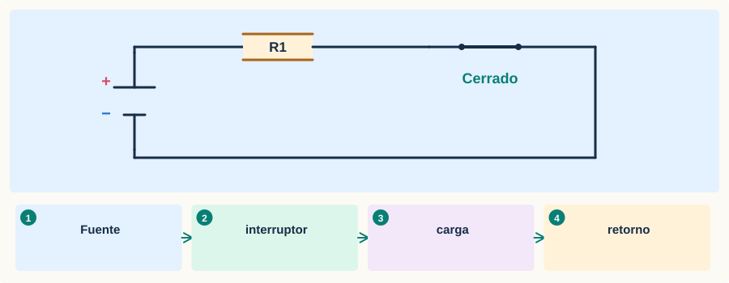

[← Portada](../README.md) · [Índice](../README.md) · [Siguiente →](02.md)

# 01 · Qué es un circuito

*Diagrama didáctico y secuencia conceptual; no a escala.*

## ¿Qué es y por qué ocurre?

Un circuito eléctrico es una red de componentes conectados por caminos conductores. Nodo: conjunto de puntos unidos por conductor ideal; rama: camino entre nodos con elemento(s); lazo: camino cerrado. Un esquema representa conectividad, no ubicación física.

## Ejemplo explicado

> Una pila, interruptor y resistor forman un lazo si están conectados en serie.

## Ahora tú

¿Cambiar la forma del dibujo sin cambiar conexiones cambia el circuito ideal?

[← Portada](../README.md) · [Índice](../README.md) · [Siguiente →](02.md)
