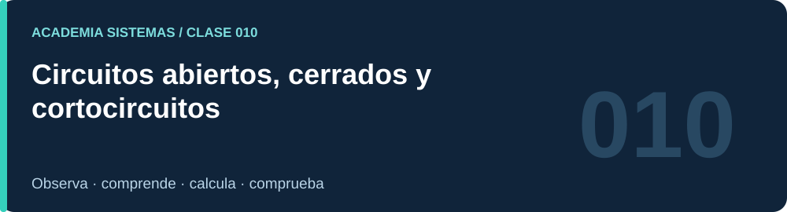
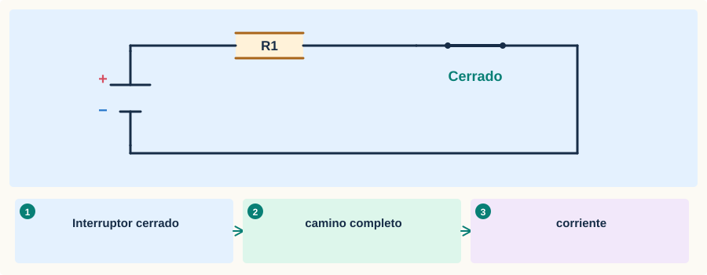
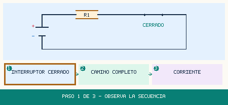

[← Anterior](01.md) · [Índice](../README.md) · [Siguiente →](03.md)

# 02 · Circuito cerrado

*Diagrama didáctico y secuencia conceptual; no a escala.*

## ¿Qué es y por qué ocurre?

Cuando el interruptor cierra el camino, una fuente puede mantener corriente por la carga. Su valor depende de la resistencia total y limitaciones de la fuente. Cerrar no significa ausencia de resistencia.

## Ejemplo explicado

> 6 V y 300 Ω: I=20 mA en modelo ideal.

## Ahora tú

3 V y 150 Ω en circuito cerrado. ¿I?

## Secuencia animada

*Se resaltan etapas del diagrama, no se pretende simular el movimiento físico real.*

[← Anterior](01.md) · [Índice](../README.md) · [Siguiente →](03.md)
