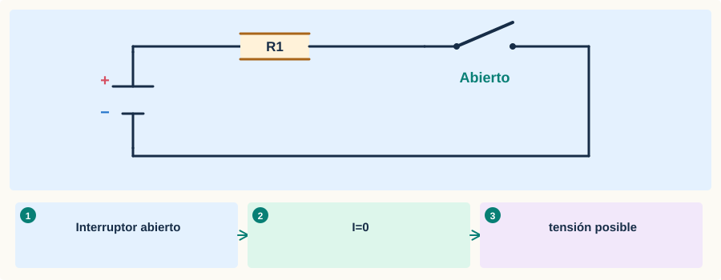

[← Anterior](02.md) · [Índice](../README.md) · [Siguiente →](04.md)

# 03 · Circuito abierto

*Diagrama didáctico y secuencia conceptual; no a escala.*

## ¿Qué es y por qué ocurre?

Un interruptor abierto interrumpe el camino. En régimen DC ideal, la corriente por ese lazo es cero, aunque pueda haber voltaje entre los contactos. Un voltímetro ideal detecta diferencia de potencial sin establecer una corriente relevante.

## Ejemplo explicado

> Si el único lazo se abre, I=0 y una caída de tensión puede aparecer en el interruptor.

## Ahora tú

¿Un interruptor abierto implica tensión cero entre sus terminales?

[← Anterior](02.md) · [Índice](../README.md) · [Siguiente →](04.md)
