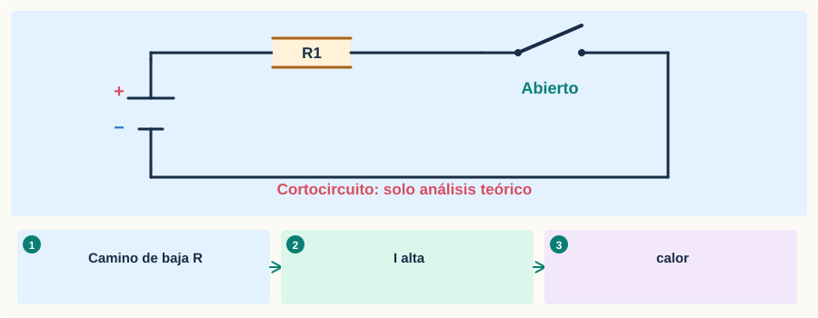

[← Anterior](03.md) · [Índice](../README.md) · [Siguiente →](05.md)

# 04 · Cortocircuito

*Diagrama didáctico y secuencia conceptual; no a escala.*

## ¿Qué es y por qué ocurre?

Un corto es una conexión no prevista de resistencia muy baja entre puntos con diferencia de potencial. El camino puede evitar la carga prevista. La corriente puede aumentar y calentar conductores, dañar la fuente o provocar incendio. No se prueba físicamente.

## Ejemplo explicado

> En el modelo 3 V y 0,5 Ω total, I=6 A; este cálculo muestra el riesgo, no un experimento.

## Ahora tú

¿Por qué un cable de baja resistencia entre bornes puede ser peligroso?

[← Anterior](03.md) · [Índice](../README.md) · [Siguiente →](05.md)
