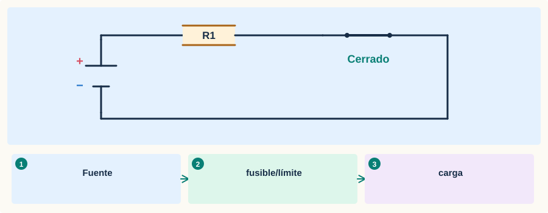

[← Anterior](04.md) · [Índice](../README.md) · [Siguiente →](06.md)

# 05 · Protección: fusible y límite de corriente

*Diagrama didáctico y secuencia conceptual; no a escala.*

## ¿Qué es y por qué ocurre?

Un fusible abre el circuito cuando la corriente y el tiempo superan su característica; protege según diseño y especificación, no garantiza protección contra cualquier contacto. Una fuente limitada reduce corriente al exceder su límite. No puentear fusibles ni reemplazarlos por valores arbitrarios.

## Ejemplo explicado

> Una fuente limitada a 50 mA no se comporta como una fuente ideal si se intenta exigir más.

## Ahora tú

¿Se reemplaza un fusible por alambre para que no se corte?

[← Anterior](04.md) · [Índice](../README.md) · [Siguiente →](06.md)
