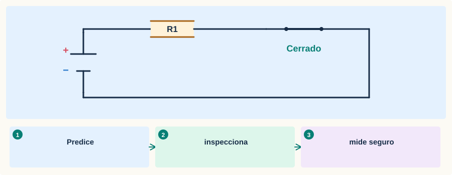

[← Anterior](05.md) · [Índice](../README.md) · [Actividades y cierre →](../descargas.md)

# 06 · Diagnóstico conceptual

*Diagrama didáctico y secuencia conceptual; no a escala.*

## ¿Qué es y por qué ocurre?

Antes de medir, dibuja el camino y predice qué pasa si se abre un contacto, si se cambia una resistencia o si hay puente no previsto. La continuidad se comprobará sin energía en clase 013. Una lámpara apagada puede deberse a varias causas, no solo falta de corriente en la fuente.

## Ejemplo explicado

> Si una conexión del único lazo se rompe, no circula corriente sostenida.

## Ahora tú

Da dos causas de circuito abierto.

[← Anterior](05.md) · [Índice](../README.md) · [Actividades y cierre →](../descargas.md)
