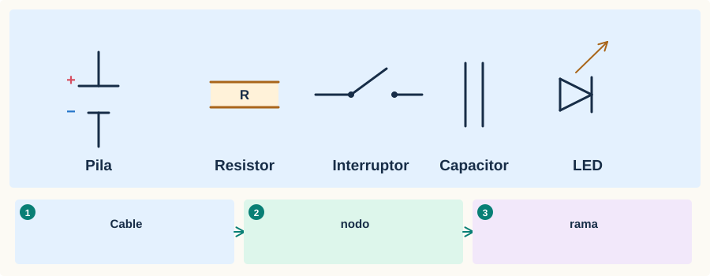
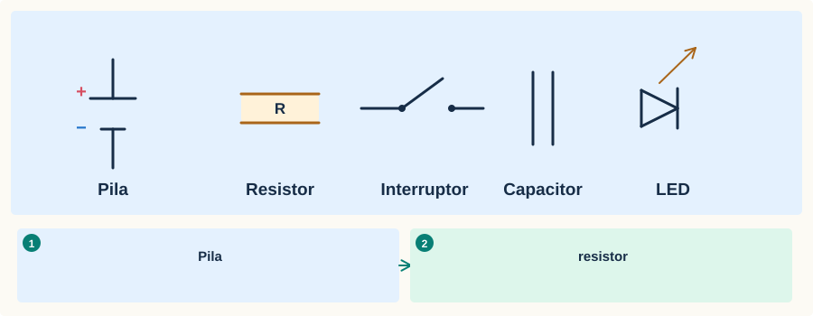
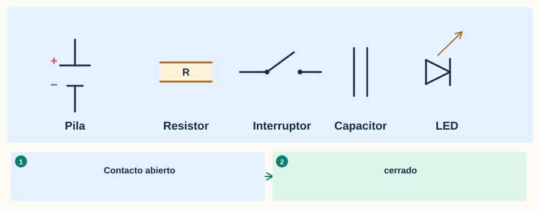
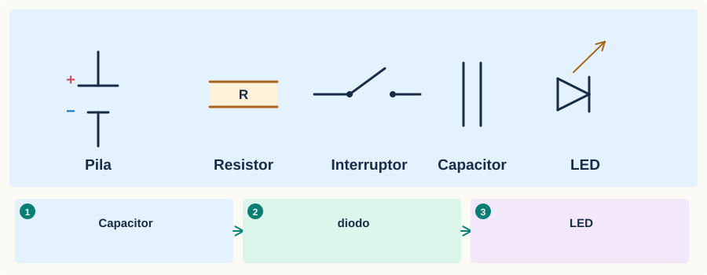
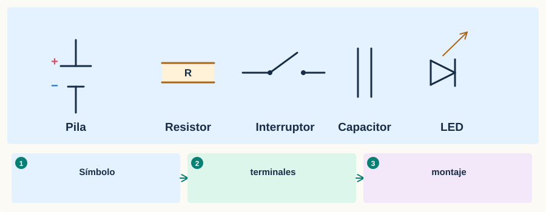
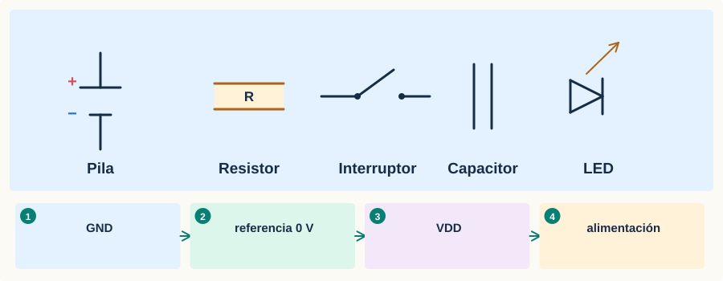

# Cuaderno de ejercicios · Clase 011

[PDF](011-ejercicios.pdf) · [← Índice](../README.md)

## 1. Leer símbolos y nodos

**Ejemplo de estudio:** Tres terminales unidos por el mismo nodo ideal tienen el mismo potencial.

**Resuelve:** ¿Un cruce sin punto representa siempre una unión?

Escribe datos, procedimiento, unidades (si corresponde), dibujo y justificación. No consultes la solución antes.

## 2. Fuente y resistor

**Ejemplo de estudio:** R1=330 Ω conectado a una pila: intercambiar extremos de un resistor común no cambia su función.

**Resuelve:** ¿Qué diferencia una pila de un resistor en el esquema?

Escribe datos, procedimiento, unidades (si corresponde), dibujo y justificación. No consultes la solución antes.

## 3. Interruptor y protección

**Ejemplo de estudio:** Un pulsador normalmente abierto cierra mientras se presiona.

**Resuelve:** ¿Qué ocurre al soltar un pulsador NO ideal?

Escribe datos, procedimiento, unidades (si corresponde), dibujo y justificación. No consultes la solución antes.

## 4. Condensador y diodo

**Ejemplo de estudio:** En un LED común la barra del símbolo identifica cátodo K; verificar encapsulado y hoja de datos.

**Resuelve:** ¿Qué indican las flechas que salen del símbolo LED?

Escribe datos, procedimiento, unidades (si corresponde), dibujo y justificación. No consultes la solución antes.

## 5. Esquema frente a montaje físico

**Ejemplo de estudio:** Un resistor y un LED en serie pueden dibujarse horizontal o verticalmente: si comparten los mismos nodos, son equivalentes.

**Resuelve:** Dibuja la misma serie de dos formas.

Escribe datos, procedimiento, unidades (si corresponde), dibujo y justificación. No consultes la solución antes.

## 6. Referencia y etiquetas

**Ejemplo de estudio:** Si VDD=3,3 V respecto a GND, no implica que el nodo GND esté conectado a tierra doméstica.

**Resuelve:** ¿GND siempre significa tierra física?

Escribe datos, procedimiento, unidades (si corresponde), dibujo y justificación. No consultes la solución antes.
