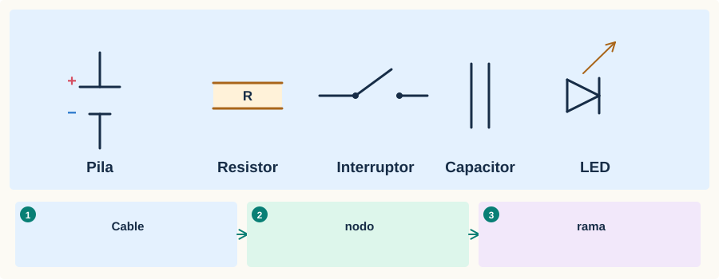
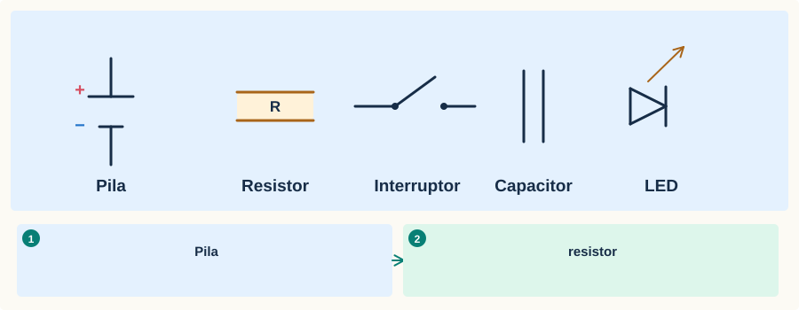
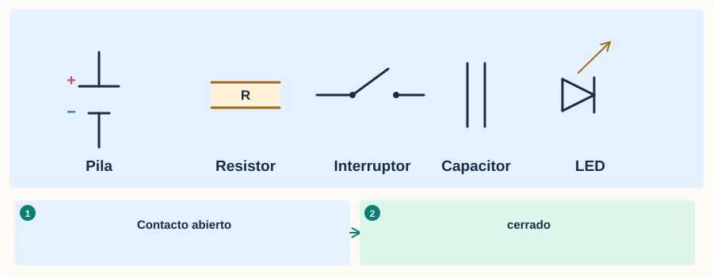
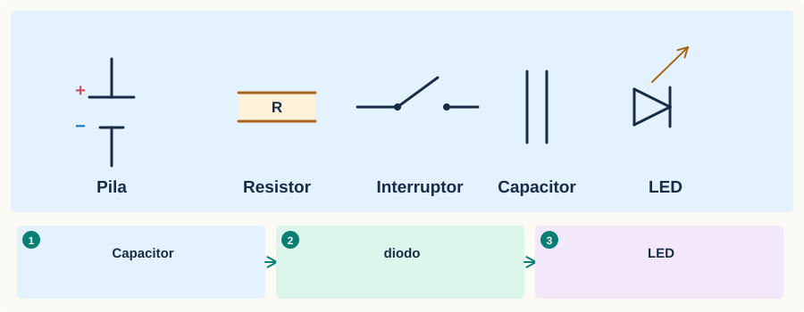
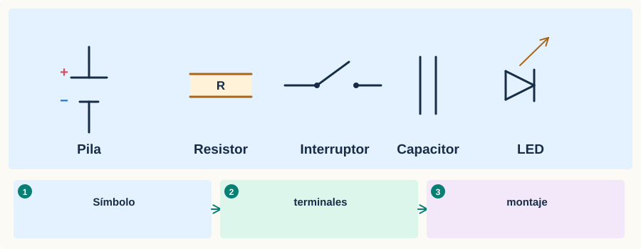
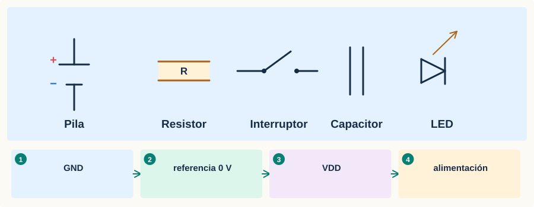

# Componentes electrónicos y simbología

[← Índice](../README.md)

## 01 · Leer símbolos y nodos

Los esquemas usan símbolos convencionales para representar función y terminales. Una línea representa conductor ideal; un punto de unión indica nodo compartido. Dos líneas que se cruzan sin unión suelen no conectarse, según convención del dibujo. Verifica siempre la leyenda.

**Ejemplo:** Tres terminales unidos por el mismo nodo ideal tienen el mismo potencial.

**Aplica:** ¿Un cruce sin punto representa siempre una unión?

---

## 02 · Fuente y resistor

La pila se dibuja con líneas larga (+) y corta (−). Un resistor puede representarse con zigzag o rectángulo, según norma. Su símbolo no indica polaridad en resistores comunes. La etiqueta R1 y el valor identifican el componente.

**Ejemplo:** R1=330 Ω conectado a una pila: intercambiar extremos de un resistor común no cambia su función.

**Aplica:** ¿Qué diferencia una pila de un resistor en el esquema?

---

## 03 · Interruptor y protección

El interruptor representa un contacto que abre o cierra un camino. Normalmente abierto significa que en reposo está abierto, no que tenga tensión cero. El fusible tiene símbolo y valor nominal según diseño; no debe confundirse con interruptor reutilizable.

**Ejemplo:** Un pulsador normalmente abierto cierra mientras se presiona.

**Aplica:** ¿Qué ocurre al soltar un pulsador NO ideal?

---

## 04 · Condensador y diodo

Un condensador ideal usa dos placas; uno polarizado exige orientación según especificación. Un diodo se representa con símbolo que incluye barra de cátodo; conduce de forma asimétrica. Un LED añade flechas de luz hacia afuera. No conectarlos a una fuente sin comprobar polaridad, tensión y limitación de corriente.

**Ejemplo:** En un LED común la barra del símbolo identifica cátodo K; verificar encapsulado y hoja de datos.

**Aplica:** ¿Qué indican las flechas que salen del símbolo LED?

---

## 05 · Esquema frente a montaje físico

Un dibujo de circuito puede estirarse o girarse sin cambiar su topología. Para pasar al montaje, identifica nodos, terminales y valores. Los componentes reales tienen tamaño, tolerancia y límites que el símbolo no muestra. La protoboard se estudia en clase 013.

**Ejemplo:** Un resistor y un LED en serie pueden dibujarse horizontal o verticalmente: si comparten los mismos nodos, son equivalentes.

**Aplica:** Dibuja la misma serie de dos formas.

---

## 06 · Referencia y etiquetas

GND suele ser referencia de potencial, no necesariamente conexión física a la Tierra. VCC/VDD suelen identificar alimentación; no todas las placas usan esas etiquetas igual. Un esquema debe indicar nombres, unidades, polaridad y referencia.

**Ejemplo:** Si VDD=3,3 V respecto a GND, no implica que el nodo GND esté conectado a tierra doméstica.

**Aplica:** ¿GND siempre significa tierra física?

---
