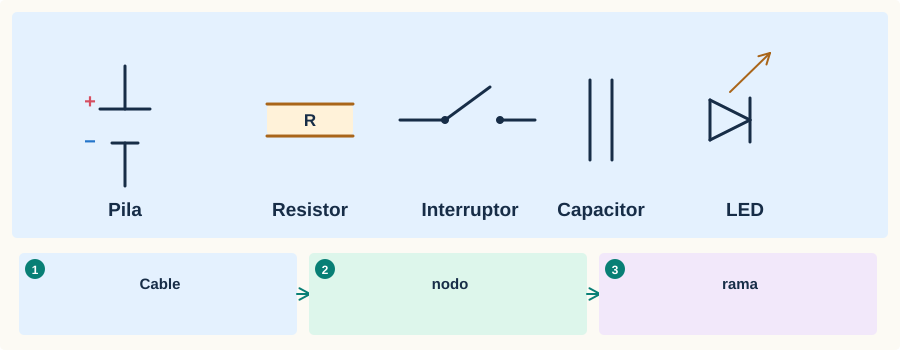

[← Portada](../README.md) · [Índice](../README.md) · [Siguiente →](02.md)

# 01 · Leer símbolos y nodos

*Diagrama didáctico y secuencia conceptual; no a escala.*

## ¿Qué es y por qué ocurre?

Los esquemas usan símbolos convencionales para representar función y terminales. Una línea representa conductor ideal; un punto de unión indica nodo compartido. Dos líneas que se cruzan sin unión suelen no conectarse, según convención del dibujo. Verifica siempre la leyenda.

## Ejemplo explicado

> Tres terminales unidos por el mismo nodo ideal tienen el mismo potencial.

## Ahora tú

¿Un cruce sin punto representa siempre una unión?

[← Portada](../README.md) · [Índice](../README.md) · [Siguiente →](02.md)
