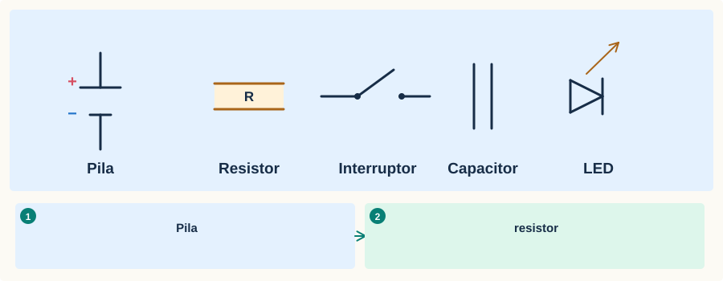
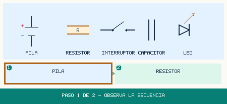

[← Anterior](01.md) · [Índice](../README.md) · [Siguiente →](03.md)

# 02 · Fuente y resistor

*Diagrama didáctico y secuencia conceptual; no a escala.*

## ¿Qué es y por qué ocurre?

La pila se dibuja con líneas larga (+) y corta (−). Un resistor puede representarse con zigzag o rectángulo, según norma. Su símbolo no indica polaridad en resistores comunes. La etiqueta R1 y el valor identifican el componente.

## Ejemplo explicado

> R1=330 Ω conectado a una pila: intercambiar extremos de un resistor común no cambia su función.

## Ahora tú

¿Qué diferencia una pila de un resistor en el esquema?

## Secuencia animada

*Se resaltan etapas del diagrama, no se pretende simular el movimiento físico real.*

[← Anterior](01.md) · [Índice](../README.md) · [Siguiente →](03.md)
