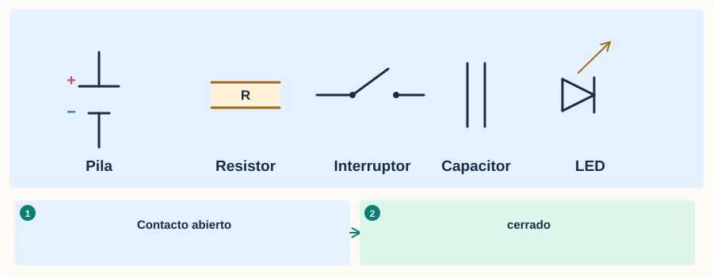

[← Anterior](02.md) · [Índice](../README.md) · [Siguiente →](04.md)

# 03 · Interruptor y protección

*Diagrama didáctico y secuencia conceptual; no a escala.*

## ¿Qué es y por qué ocurre?

El interruptor representa un contacto que abre o cierra un camino. Normalmente abierto significa que en reposo está abierto, no que tenga tensión cero. El fusible tiene símbolo y valor nominal según diseño; no debe confundirse con interruptor reutilizable.

## Ejemplo explicado

> Un pulsador normalmente abierto cierra mientras se presiona.

## Ahora tú

¿Qué ocurre al soltar un pulsador NO ideal?

[← Anterior](02.md) · [Índice](../README.md) · [Siguiente →](04.md)
