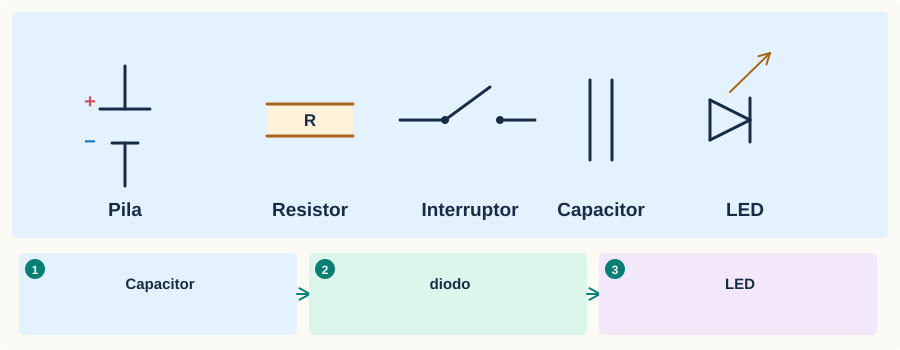

[← Anterior](03.md) · [Índice](../README.md) · [Siguiente →](05.md)

# 04 · Condensador y diodo

*Diagrama didáctico y secuencia conceptual; no a escala.*

## ¿Qué es y por qué ocurre?

Un condensador ideal usa dos placas; uno polarizado exige orientación según especificación. Un diodo se representa con símbolo que incluye barra de cátodo; conduce de forma asimétrica. Un LED añade flechas de luz hacia afuera. No conectarlos a una fuente sin comprobar polaridad, tensión y limitación de corriente.

## Ejemplo explicado

> En un LED común la barra del símbolo identifica cátodo K; verificar encapsulado y hoja de datos.

## Ahora tú

¿Qué indican las flechas que salen del símbolo LED?

[← Anterior](03.md) · [Índice](../README.md) · [Siguiente →](05.md)
