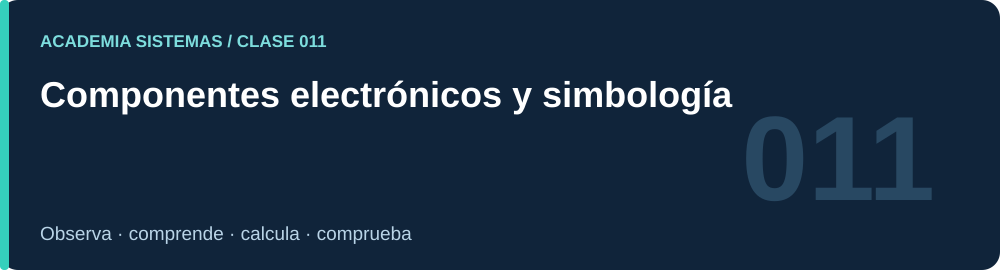
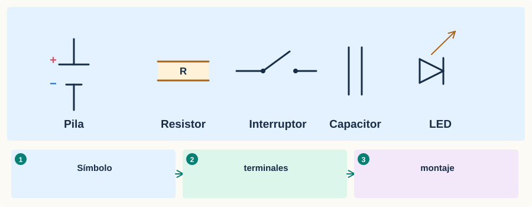

[← Anterior](04.md) · [Índice](../README.md) · [Siguiente →](06.md)

# 05 · Esquema frente a montaje físico

*Diagrama didáctico y secuencia conceptual; no a escala.*

## ¿Qué es y por qué ocurre?

Un dibujo de circuito puede estirarse o girarse sin cambiar su topología. Para pasar al montaje, identifica nodos, terminales y valores. Los componentes reales tienen tamaño, tolerancia y límites que el símbolo no muestra. La protoboard se estudia en clase 013.

## Ejemplo explicado

> Un resistor y un LED en serie pueden dibujarse horizontal o verticalmente: si comparten los mismos nodos, son equivalentes.

## Ahora tú

Dibuja la misma serie de dos formas.

[← Anterior](04.md) · [Índice](../README.md) · [Siguiente →](06.md)
