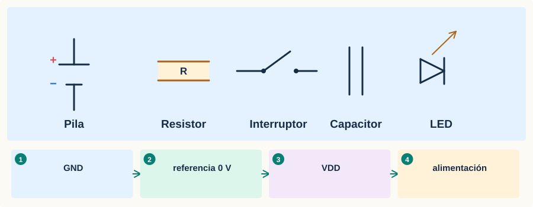

[← Anterior](05.md) · [Índice](../README.md) · [Actividades y cierre →](../descargas.md)

# 06 · Referencia y etiquetas

*Diagrama didáctico y secuencia conceptual; no a escala.*

## ¿Qué es y por qué ocurre?

GND suele ser referencia de potencial, no necesariamente conexión física a la Tierra. VCC/VDD suelen identificar alimentación; no todas las placas usan esas etiquetas igual. Un esquema debe indicar nombres, unidades, polaridad y referencia.

## Ejemplo explicado

> Si VDD=3,3 V respecto a GND, no implica que el nodo GND esté conectado a tierra doméstica.

## Ahora tú

¿GND siempre significa tierra física?

[← Anterior](05.md) · [Índice](../README.md) · [Actividades y cierre →](../descargas.md)
