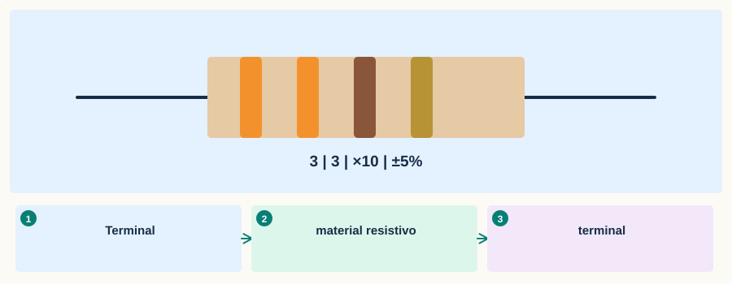
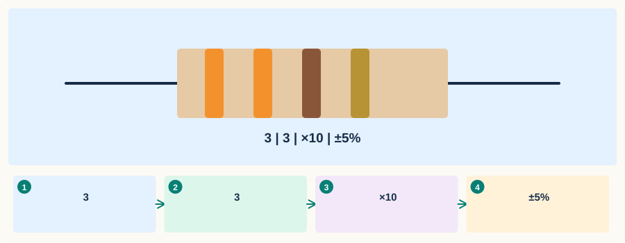
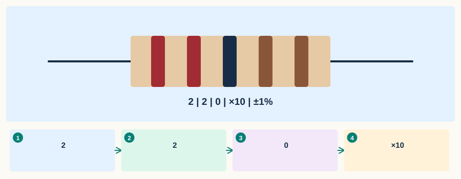
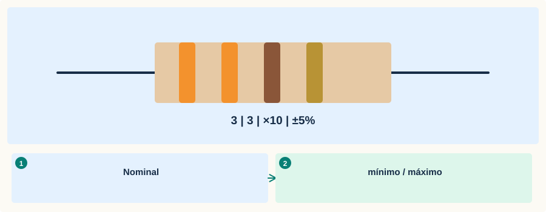
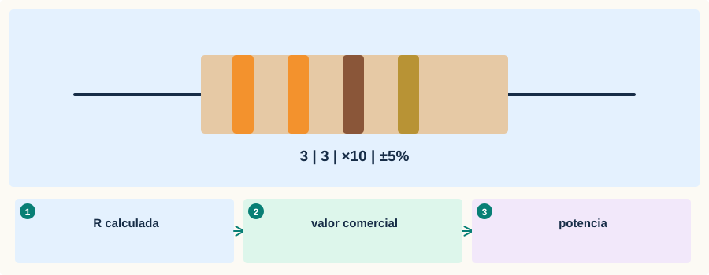
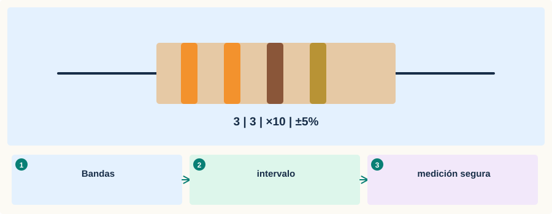

# Cuaderno de ejercicios · Clase 012

[PDF](012-ejercicios.pdf) · [← Índice](../README.md)

## 1. Cómo se fabrica un resistor

**Ejemplo de estudio:** Una película larga y delgada puede aumentar la resistencia sin cambiar material.

**Resuelve:** ¿Por qué un resistor de potencia suele tener cuerpo más grande?

Escribe datos, procedimiento, unidades (si corresponde), dibujo y justificación. No consultes la solución antes.

## 2. Código de cuatro bandas

**Ejemplo de estudio:** Naranja-naranja-marrón-oro: 33×10=330 Ω ±5%.

**Resuelve:** Marrón-negro-rojo-oro. ¿Valor?

Escribe datos, procedimiento, unidades (si corresponde), dibujo y justificación. No consultes la solución antes.

## 3. Cinco bandas

**Ejemplo de estudio:** Marrón-negro-negro-rojo-marrón: 100×100=10 kΩ ±1%.

**Resuelve:** Rojo-rojo-negro-marrón-marrón. ¿Valor?

Escribe datos, procedimiento, unidades (si corresponde), dibujo y justificación. No consultes la solución antes.

## 4. Tolerancia e intervalo

**Ejemplo de estudio:** 330 Ω ±5%: 313,5 a 346,5 Ω.

**Resuelve:** 1 kΩ ±1%. Calcula intervalo.

Escribe datos, procedimiento, unidades (si corresponde), dibujo y justificación. No consultes la solución antes.

## 5. Valores comerciales y elección

**Ejemplo de estudio:** 5 V / 330 Ω≈15,15 mA para un resistor solo ideal; con LED se resta su caída aproximada.

**Resuelve:** ¿Un resistor de 1 kΩ y otro de 1 kΩ pero diferente potencia son idénticos en todo?

Escribe datos, procedimiento, unidades (si corresponde), dibujo y justificación. No consultes la solución antes.

## 6. Lectura y verificación

**Ejemplo de estudio:** Un resistor nominal de 330 Ω ±5% medido aislado a 340 Ω puede estar dentro de tolerancia.

**Resuelve:** ¿350 Ω cumple nominal 330 Ω ±5% ignorando incertidumbre?

Escribe datos, procedimiento, unidades (si corresponde), dibujo y justificación. No consultes la solución antes.
