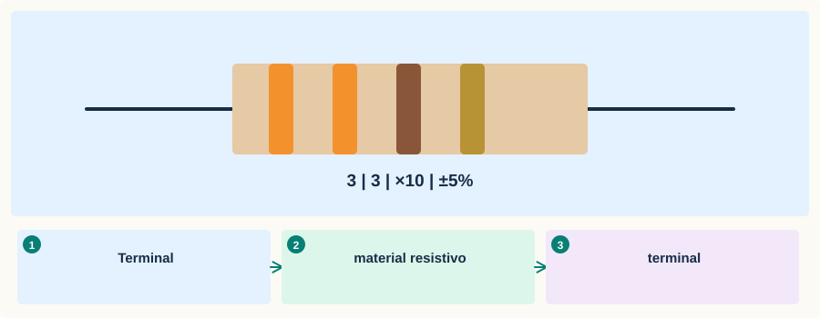
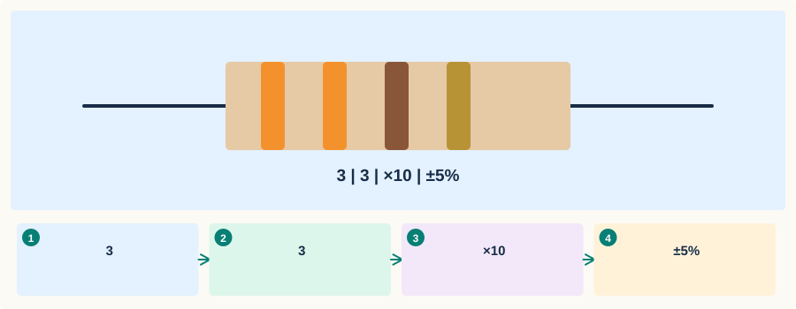
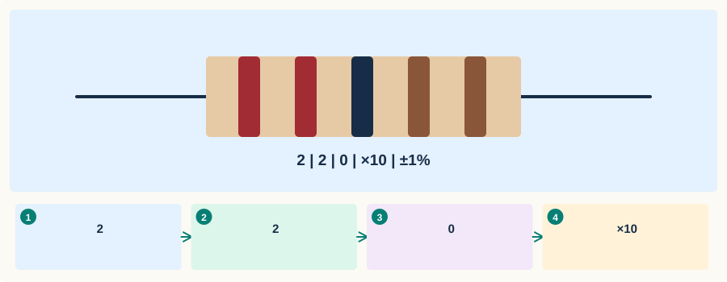
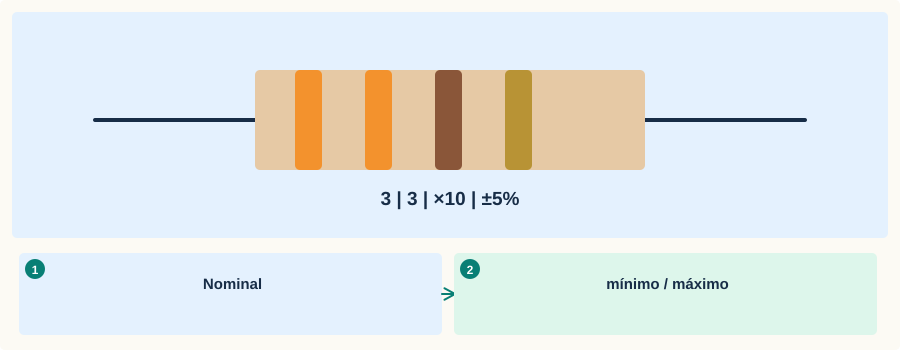
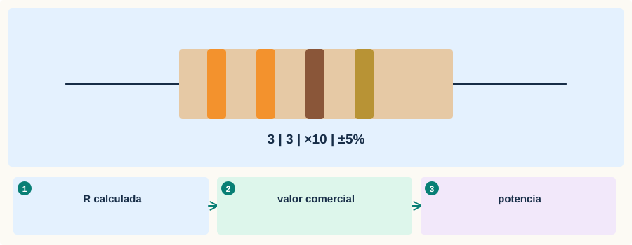
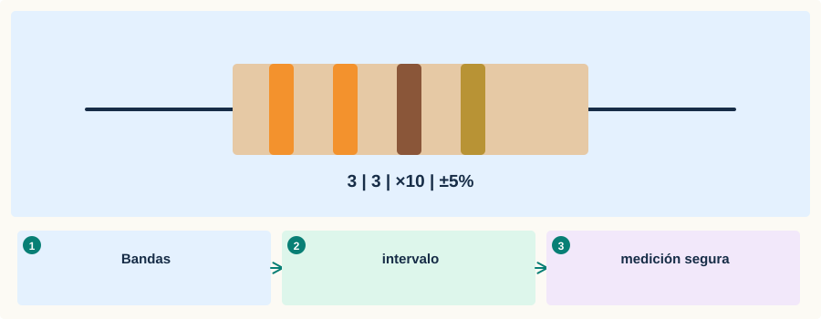

# Resistencias comerciales y código de colores

[← Índice](../README.md)

## 01 · Cómo se fabrica un resistor

Un resistor puede usar película de carbono o metal sobre cerámica, material resistivo masivo o alambre resistivo. Su composición y geometría controlan R; los terminales permiten conectarlo. El encapsulado limita temperatura y protege. Distintos tipos sirven para potencias, tolerancias o frecuencias diferentes.

**Ejemplo:** Una película larga y delgada puede aumentar la resistencia sin cambiar material.

**Aplica:** ¿Por qué un resistor de potencia suele tener cuerpo más grande?

---

## 02 · Código de cuatro bandas

Las dos primeras bandas son cifras; la tercera multiplicador 10ⁿ y la cuarta tolerancia. Dígitos: negro 0, marrón 1, rojo 2, naranja 3, amarillo 4, verde 5, azul 6, violeta 7, gris 8, blanco 9. Oro multiplicador 0,1 o tolerancia ±5%; plata 0,01 o ±10%.

**Ejemplo:** Naranja-naranja-marrón-oro: 33×10=330 Ω ±5%.

**Aplica:** Marrón-negro-rojo-oro. ¿Valor?

---

## 03 · Cinco bandas

En un resistor de cinco bandas, normalmente hay tres cifras significativas, multiplicador y tolerancia. Algunas marcas especiales añaden coeficiente térmico; verifica fabricante. La banda de tolerancia suele estar más separada, pero no es una regla infalible.

**Ejemplo:** Marrón-negro-negro-rojo-marrón: 100×100=10 kΩ ±1%.

**Aplica:** Rojo-rojo-negro-marrón-marrón. ¿Valor?

---

## 04 · Tolerancia e intervalo

La tolerancia expresa desviación permitida respecto al valor nominal en condiciones especificadas. Rmin=Rnom(1−t), Rmax=Rnom(1+t), con t fracción. Temperatura, envejecimiento e incertidumbre de medición también pueden influir.

**Ejemplo:** 330 Ω ±5%: 313,5 a 346,5 Ω.

**Aplica:** 1 kΩ ±1%. Calcula intervalo.

---

## 05 · Valores comerciales y elección

Los valores comerciales se organizan en series preferidas, por ejemplo E12. Si el cálculo requiere 300 Ω y hay 330 Ω, evalúa la corriente real y si satisface el requisito. Para proteger un LED suele convenir redondear hacia una resistencia mayor si cumple el brillo deseado. Comprueba potencia nominal.

**Ejemplo:** 5 V / 330 Ω≈15,15 mA para un resistor solo ideal; con LED se resta su caída aproximada.

**Aplica:** ¿Un resistor de 1 kΩ y otro de 1 kΩ pero diferente potencia son idénticos en todo?

---

## 06 · Lectura y verificación

Antes de medir resistencia, desenergiza el circuito y descarga elementos almacenadores con procedimiento seguro. Una medición en circuito puede incluir caminos paralelos. En clase 013 se aprenderá a aislar el componente y usar Ω correctamente. No deduzcas potencia solo por las bandas.

**Ejemplo:** Un resistor nominal de 330 Ω ±5% medido aislado a 340 Ω puede estar dentro de tolerancia.

**Aplica:** ¿350 Ω cumple nominal 330 Ω ±5% ignorando incertidumbre?

---
