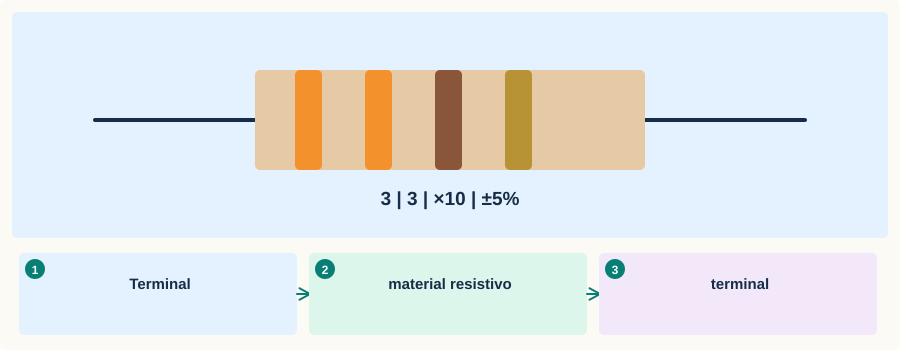

[← Portada](../README.md) · [Índice](../README.md) · [Siguiente →](02.md)

# 01 · Cómo se fabrica un resistor

*Diagrama didáctico y secuencia conceptual; no a escala.*

## ¿Qué es y por qué ocurre?

Un resistor puede usar película de carbono o metal sobre cerámica, material resistivo masivo o alambre resistivo. Su composición y geometría controlan R; los terminales permiten conectarlo. El encapsulado limita temperatura y protege. Distintos tipos sirven para potencias, tolerancias o frecuencias diferentes.

## Ejemplo explicado

> Una película larga y delgada puede aumentar la resistencia sin cambiar material.

## Ahora tú

¿Por qué un resistor de potencia suele tener cuerpo más grande?

[← Portada](../README.md) · [Índice](../README.md) · [Siguiente →](02.md)
