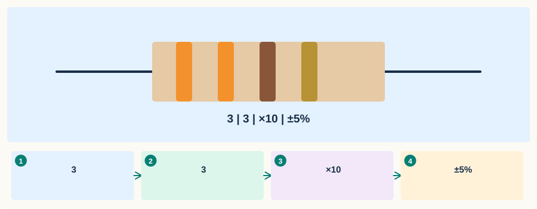
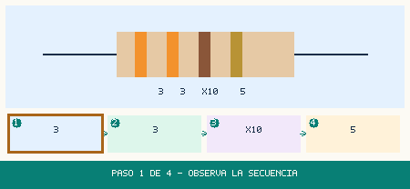

[← Anterior](01.md) · [Índice](../README.md) · [Siguiente →](03.md)

# 02 · Código de cuatro bandas

*Diagrama didáctico y secuencia conceptual; no a escala.*

## ¿Qué es y por qué ocurre?

Las dos primeras bandas son cifras; la tercera multiplicador 10ⁿ y la cuarta tolerancia. Dígitos: negro 0, marrón 1, rojo 2, naranja 3, amarillo 4, verde 5, azul 6, violeta 7, gris 8, blanco 9. Oro multiplicador 0,1 o tolerancia ±5%; plata 0,01 o ±10%.

## Ejemplo explicado

> Naranja-naranja-marrón-oro: 33×10=330 Ω ±5%.

## Ahora tú

Marrón-negro-rojo-oro. ¿Valor?

## Secuencia animada

*Se resaltan etapas del diagrama, no se pretende simular el movimiento físico real.*

[← Anterior](01.md) · [Índice](../README.md) · [Siguiente →](03.md)
