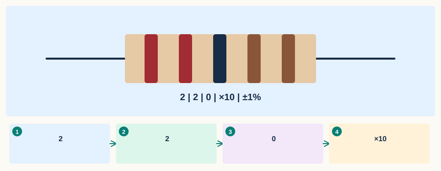

[← Anterior](02.md) · [Índice](../README.md) · [Siguiente →](04.md)

# 03 · Cinco bandas

*Diagrama didáctico y secuencia conceptual; no a escala.*

## ¿Qué es y por qué ocurre?

En un resistor de cinco bandas, normalmente hay tres cifras significativas, multiplicador y tolerancia. Algunas marcas especiales añaden coeficiente térmico; verifica fabricante. La banda de tolerancia suele estar más separada, pero no es una regla infalible.

## Ejemplo explicado

> Marrón-negro-negro-rojo-marrón: 100×100=10 kΩ ±1%.

## Ahora tú

Rojo-rojo-negro-marrón-marrón. ¿Valor?

[← Anterior](02.md) · [Índice](../README.md) · [Siguiente →](04.md)
