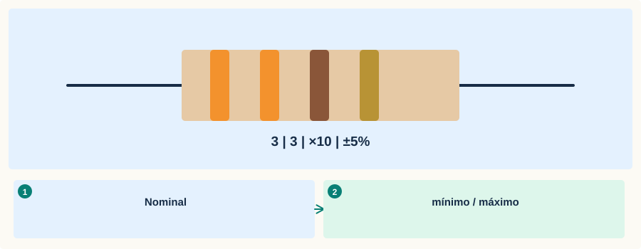

[← Anterior](03.md) · [Índice](../README.md) · [Siguiente →](05.md)

# 04 · Tolerancia e intervalo

*Diagrama didáctico y secuencia conceptual; no a escala.*

## ¿Qué es y por qué ocurre?

La tolerancia expresa desviación permitida respecto al valor nominal en condiciones especificadas. Rmin=Rnom(1−t), Rmax=Rnom(1+t), con t fracción. Temperatura, envejecimiento e incertidumbre de medición también pueden influir.

## Ejemplo explicado

> 330 Ω ±5%: 313,5 a 346,5 Ω.

## Ahora tú

1 kΩ ±1%. Calcula intervalo.

[← Anterior](03.md) · [Índice](../README.md) · [Siguiente →](05.md)
