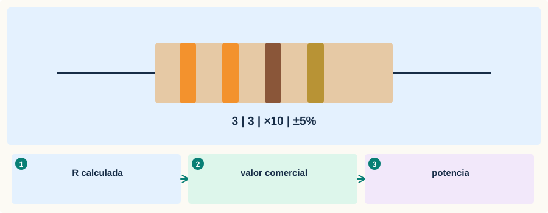

[← Anterior](04.md) · [Índice](../README.md) · [Siguiente →](06.md)

# 05 · Valores comerciales y elección

*Diagrama didáctico y secuencia conceptual; no a escala.*

## ¿Qué es y por qué ocurre?

Los valores comerciales se organizan en series preferidas, por ejemplo E12. Si el cálculo requiere 300 Ω y hay 330 Ω, evalúa la corriente real y si satisface el requisito. Para proteger un LED suele convenir redondear hacia una resistencia mayor si cumple el brillo deseado. Comprueba potencia nominal.

## Ejemplo explicado

> 5 V / 330 Ω≈15,15 mA para un resistor solo ideal; con LED se resta su caída aproximada.

## Ahora tú

¿Un resistor de 1 kΩ y otro de 1 kΩ pero diferente potencia son idénticos en todo?

[← Anterior](04.md) · [Índice](../README.md) · [Siguiente →](06.md)
