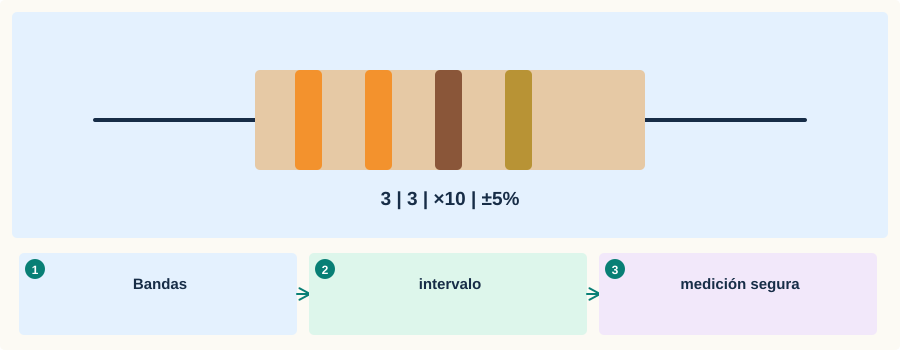

[← Anterior](05.md) · [Índice](../README.md) · [Actividades y cierre →](../descargas.md)

# 06 · Lectura y verificación

*Diagrama didáctico y secuencia conceptual; no a escala.*

## ¿Qué es y por qué ocurre?

Antes de medir resistencia, desenergiza el circuito y descarga elementos almacenadores con procedimiento seguro. Una medición en circuito puede incluir caminos paralelos. En clase 013 se aprenderá a aislar el componente y usar Ω correctamente. No deduzcas potencia solo por las bandas.

## Ejemplo explicado

> Un resistor nominal de 330 Ω ±5% medido aislado a 340 Ω puede estar dentro de tolerancia.

## Ahora tú

¿350 Ω cumple nominal 330 Ω ±5% ignorando incertidumbre?

[← Anterior](05.md) · [Índice](../README.md) · [Actividades y cierre →](../descargas.md)
