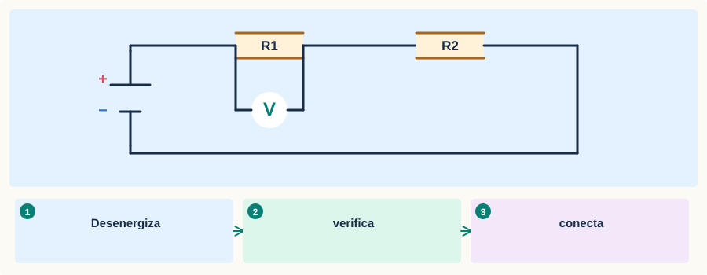
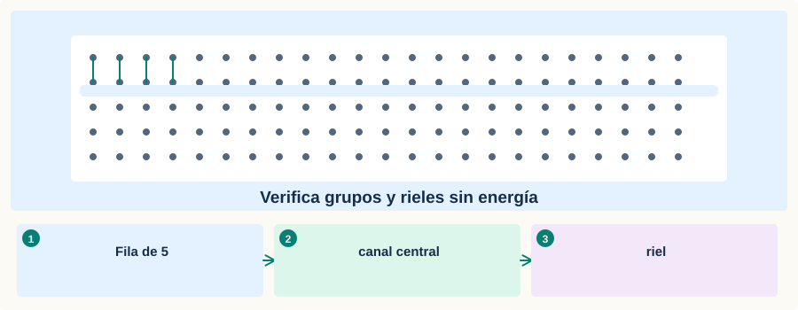
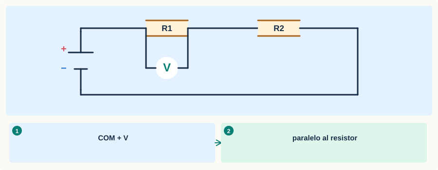
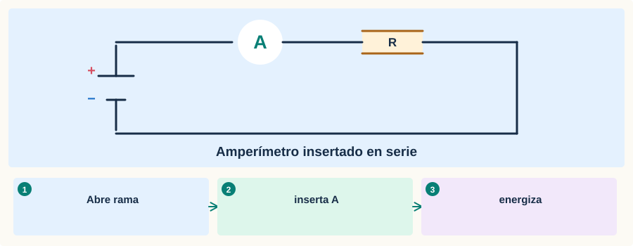
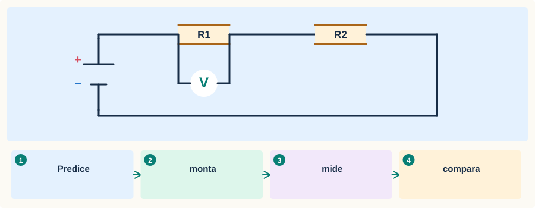

# Cuaderno de ejercicios · Clase 013

[PDF](013-ejercicios.pdf) · [← Índice](../README.md)

## 1. Seguridad antes de medir

**Ejemplo de estudio:** Para 3 V y 330 Ω, I≈9,1 mA y P≈27 mW; un resistor de 0,25 W tiene margen ideal.

**Resuelve:** ¿Qué haces antes de mover un cable del montaje?

Escribe datos, procedimiento, unidades (si corresponde), dibujo y justificación. No consultes la solución antes.

## 2. Protoboard: conexiones internas

**Ejemplo de estudio:** Dos patas del resistor en el mismo grupo quedan en el mismo nodo y no insertan R en la trayectoria.

**Resuelve:** ¿Puedo asumir que toda línea roja del riel está conectada?

Escribe datos, procedimiento, unidades (si corresponde), dibujo y justificación. No consultes la solución antes.

## 3. Bornes y medición de voltaje

**Ejemplo de estudio:** Puntas entre extremos de resistor conectado a pila ideal de 3 V: aproximadamente 3 V, si es la única carga.

**Resuelve:** ¿Voltímetro en serie o paralelo?

Escribe datos, procedimiento, unidades (si corresponde), dibujo y justificación. No consultes la solución antes.

## 4. Medición de corriente

**Ejemplo de estudio:** En 3 V y 330 Ω se espera ≈9,1 mA. El amperímetro real introduce caída (burden voltage).

**Resuelve:** ¿Por qué no se mide I en paralelo a la fuente?

Escribe datos, procedimiento, unidades (si corresponde), dibujo y justificación. No consultes la solución antes.

## 5. Resistencia y continuidad

**Ejemplo de estudio:** Dos resistores en paralelo pueden hacer que midas un equivalente menor que el valor individual.

**Resuelve:** ¿Se mide Ω en circuito alimentado?

Escribe datos, procedimiento, unidades (si corresponde), dibujo y justificación. No consultes la solución antes.

## 6. Montaje y diagnóstico supervisado

**Ejemplo de estudio:** Si V=2,9 V y R=340 Ω, I ideal≈8,53 mA; una diferencia razonable puede deberse a tolerancias e instrumento.

**Resuelve:** ¿Qué valores esperas con 3 V y 330 Ω?

Escribe datos, procedimiento, unidades (si corresponde), dibujo y justificación. No consultes la solución antes.
