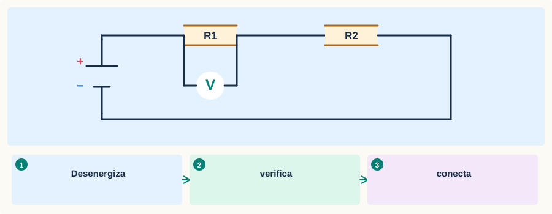
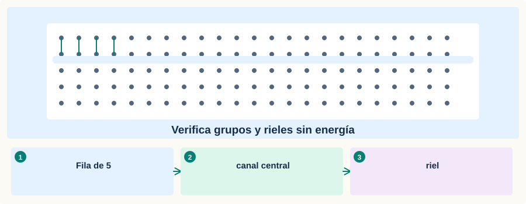
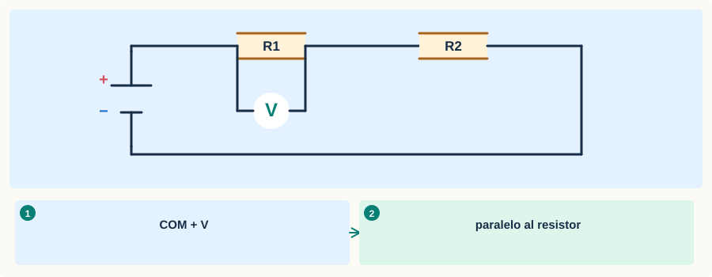
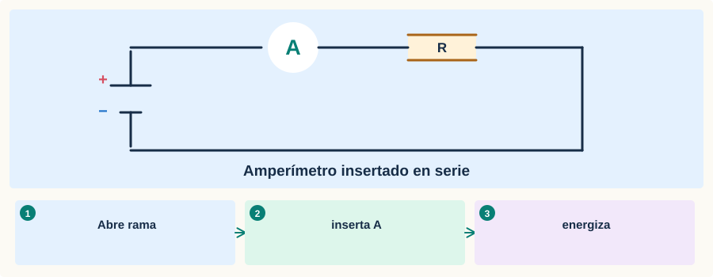
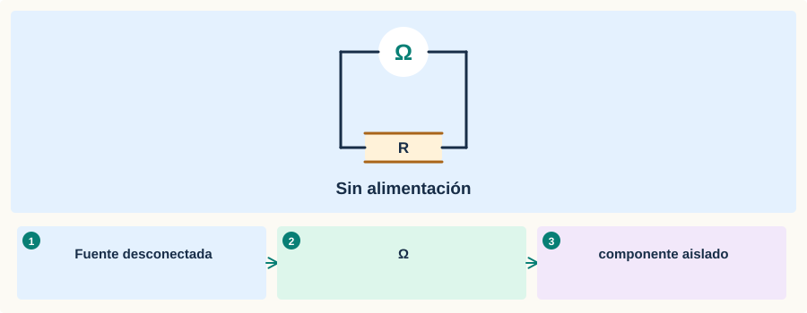
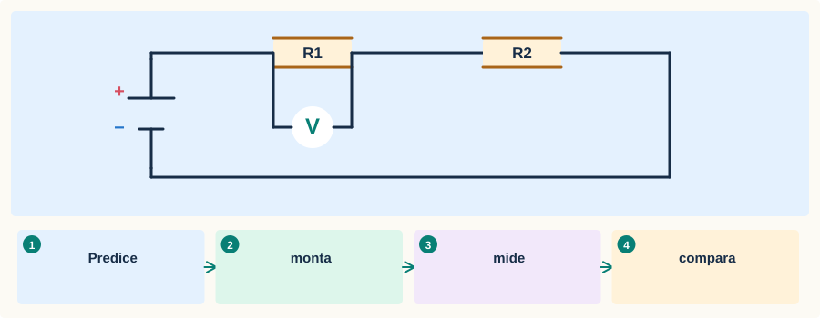

# Protoboard y multímetro

[← Índice](../README.md)

## 01 · Seguridad antes de medir

Las prácticas usan solo 3–6 V DC con fuente limitada o portapilas apropiado, supervisión y resistores adecuados. No usar red doméstica, cargadores abiertos, baterías dañadas ni generar cortos. Desconecta antes de modificar cableado. Comprueba cables, bornes, función y rango del multímetro antes de energizar.

**Ejemplo:** Para 3 V y 330 Ω, I≈9,1 mA y P≈27 mW; un resistor de 0,25 W tiene margen ideal.

**Aplica:** ¿Qué haces antes de mover un cable del montaje?

---

## 02 · Protoboard: conexiones internas

En una placa típica, grupos de cinco agujeros en cada lado del canal central están conectados internamente; lados opuestos no lo están. Los rieles laterales pueden estar partidos y no siempre se conectan de extremo a extremo. Verifica con continuidad sin alimentación; no supongas por colores.

**Ejemplo:** Dos patas del resistor en el mismo grupo quedan en el mismo nodo y no insertan R en la trayectoria.

**Aplica:** ¿Puedo asumir que toda línea roja del riel está conectada?

---

## 03 · Bornes y medición de voltaje

Negro en COM; rojo en borne V/Ω según modelo. Selecciona DC V y rango apropiado o autorango. Conecta en paralelo con el elemento; la alta impedancia del voltímetro limita la corriente que introduce. Observa polaridad y referencia.

**Ejemplo:** Puntas entre extremos de resistor conectado a pila ideal de 3 V: aproximadamente 3 V, si es la única carga.

**Aplica:** ¿Voltímetro en serie o paralelo?

---

## 04 · Medición de corriente

Desconecta fuente. Selecciona DC A, borne de corriente adecuado con fusible según manual y rango inicial superior al esperado. Abre el camino e inserta el instrumento en serie; energiza solo tras revisión. No conectar amperímetro directamente entre bornes. Al terminar, desconecta y devuelve punta roja a V/Ω.

**Ejemplo:** En 3 V y 330 Ω se espera ≈9,1 mA. El amperímetro real introduce caída (burden voltage).

**Aplica:** ¿Por qué no se mide I en paralelo a la fuente?

---

## 05 · Resistencia y continuidad

Selecciona Ω o continuidad solo con circuito sin energía y capacitores descargados de manera segura. El instrumento aplica su propia señal. Para medir un resistor, aísla al menos un terminal si existen caminos alternos. El pitido de continuidad no significa exactamente cero ohmios; depende del umbral.

**Ejemplo:** Dos resistores en paralelo pueden hacer que midas un equivalente menor que el valor individual.

**Aplica:** ¿Se mide Ω en circuito alimentado?

---

## 06 · Montaje y diagnóstico supervisado

Montaje: fuente 3 V, resistor 330 Ω, interruptor, retorno. Primero comprueba continuidad y ausencia de puentes; después mide tensión de fuente y resistor. Si el docente aprueba, mide corriente en serie. Registra unidad, rango e incertidumbre; compara con predicción y tolerancia. Detente si hay calor anormal, olor o daño.

**Ejemplo:** Si V=2,9 V y R=340 Ω, I ideal≈8,53 mA; una diferencia razonable puede deberse a tolerancias e instrumento.

**Aplica:** ¿Qué valores esperas con 3 V y 330 Ω?

---
