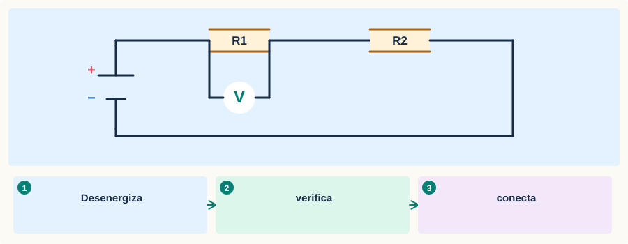

[← Portada](../README.md) · [Índice](../README.md) · [Siguiente →](02.md)

# 01 · Seguridad antes de medir

*Diagrama didáctico y secuencia conceptual; no a escala.*

## ¿Qué es y por qué ocurre?

Las prácticas usan solo 3–6 V DC con fuente limitada o portapilas apropiado, supervisión y resistores adecuados. No usar red doméstica, cargadores abiertos, baterías dañadas ni generar cortos. Desconecta antes de modificar cableado. Comprueba cables, bornes, función y rango del multímetro antes de energizar.

## Ejemplo explicado

> Para 3 V y 330 Ω, I≈9,1 mA y P≈27 mW; un resistor de 0,25 W tiene margen ideal.

## Ahora tú

¿Qué haces antes de mover un cable del montaje?

[← Portada](../README.md) · [Índice](../README.md) · [Siguiente →](02.md)
