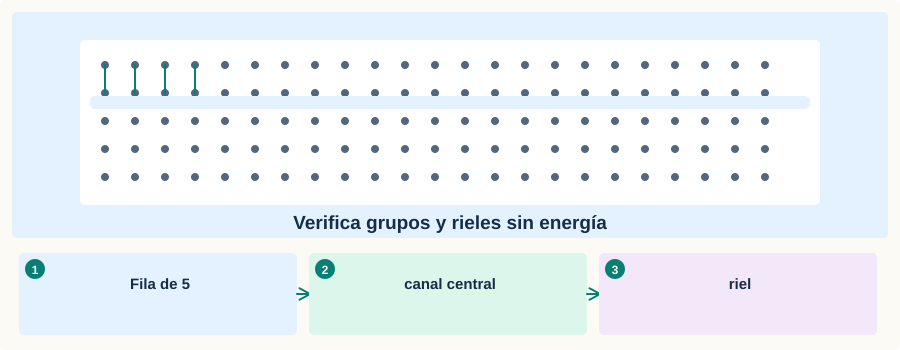
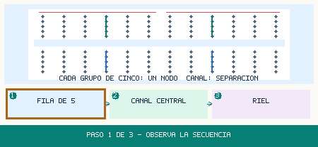

[← Anterior](01.md) · [Índice](../README.md) · [Siguiente →](03.md)

# 02 · Protoboard: conexiones internas

*Diagrama didáctico y secuencia conceptual; no a escala.*

## ¿Qué es y por qué ocurre?

En una placa típica, grupos de cinco agujeros en cada lado del canal central están conectados internamente; lados opuestos no lo están. Los rieles laterales pueden estar partidos y no siempre se conectan de extremo a extremo. Verifica con continuidad sin alimentación; no supongas por colores.

## Ejemplo explicado

> Dos patas del resistor en el mismo grupo quedan en el mismo nodo y no insertan R en la trayectoria.

## Ahora tú

¿Puedo asumir que toda línea roja del riel está conectada?

## Secuencia animada

*Se resaltan etapas del diagrama, no se pretende simular el movimiento físico real.*

[← Anterior](01.md) · [Índice](../README.md) · [Siguiente →](03.md)
