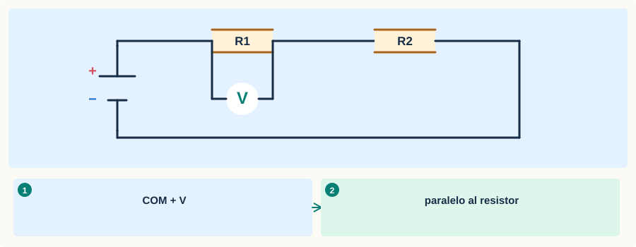

[← Anterior](02.md) · [Índice](../README.md) · [Siguiente →](04.md)

# 03 · Bornes y medición de voltaje

*Diagrama didáctico y secuencia conceptual; no a escala.*

## ¿Qué es y por qué ocurre?

Negro en COM; rojo en borne V/Ω según modelo. Selecciona DC V y rango apropiado o autorango. Conecta en paralelo con el elemento; la alta impedancia del voltímetro limita la corriente que introduce. Observa polaridad y referencia.

## Ejemplo explicado

> Puntas entre extremos de resistor conectado a pila ideal de 3 V: aproximadamente 3 V, si es la única carga.

## Ahora tú

¿Voltímetro en serie o paralelo?

[← Anterior](02.md) · [Índice](../README.md) · [Siguiente →](04.md)
