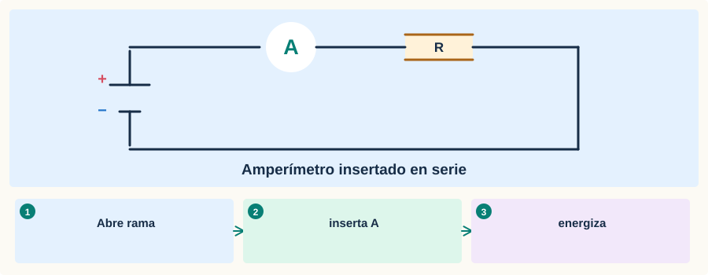

[← Anterior](03.md) · [Índice](../README.md) · [Siguiente →](05.md)

# 04 · Medición de corriente

*Diagrama didáctico y secuencia conceptual; no a escala.*

## ¿Qué es y por qué ocurre?

Desconecta fuente. Selecciona DC A, borne de corriente adecuado con fusible según manual y rango inicial superior al esperado. Abre el camino e inserta el instrumento en serie; energiza solo tras revisión. No conectar amperímetro directamente entre bornes. Al terminar, desconecta y devuelve punta roja a V/Ω.

## Ejemplo explicado

> En 3 V y 330 Ω se espera ≈9,1 mA. El amperímetro real introduce caída (burden voltage).

## Ahora tú

¿Por qué no se mide I en paralelo a la fuente?

[← Anterior](03.md) · [Índice](../README.md) · [Siguiente →](05.md)
