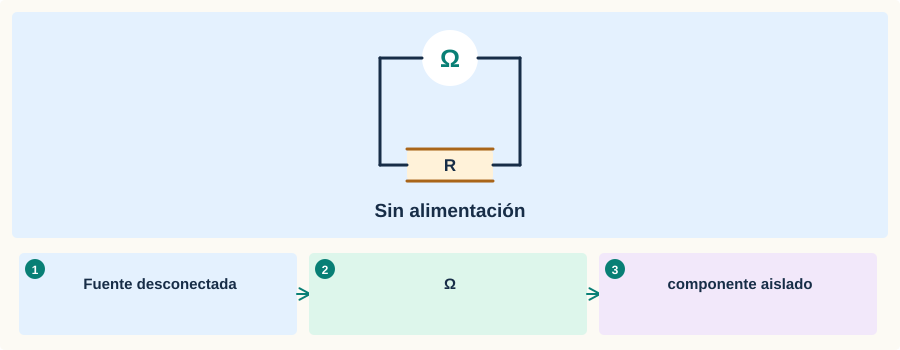

[← Anterior](04.md) · [Índice](../README.md) · [Siguiente →](06.md)

# 05 · Resistencia y continuidad

*Diagrama didáctico y secuencia conceptual; no a escala.*

## ¿Qué es y por qué ocurre?

Selecciona Ω o continuidad solo con circuito sin energía y capacitores descargados de manera segura. El instrumento aplica su propia señal. Para medir un resistor, aísla al menos un terminal si existen caminos alternos. El pitido de continuidad no significa exactamente cero ohmios; depende del umbral.

## Ejemplo explicado

> Dos resistores en paralelo pueden hacer que midas un equivalente menor que el valor individual.

## Ahora tú

¿Se mide Ω en circuito alimentado?

[← Anterior](04.md) · [Índice](../README.md) · [Siguiente →](06.md)
