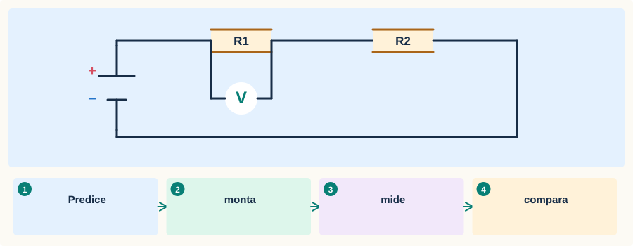

[← Anterior](05.md) · [Índice](../README.md) · [Actividades y cierre →](../descargas.md)

# 06 · Montaje y diagnóstico supervisado

*Diagrama didáctico y secuencia conceptual; no a escala.*

## ¿Qué es y por qué ocurre?

Montaje: fuente 3 V, resistor 330 Ω, interruptor, retorno. Primero comprueba continuidad y ausencia de puentes; después mide tensión de fuente y resistor. Si el docente aprueba, mide corriente en serie. Registra unidad, rango e incertidumbre; compara con predicción y tolerancia. Detente si hay calor anormal, olor o daño.

## Ejemplo explicado

> Si V=2,9 V y R=340 Ω, I ideal≈8,53 mA; una diferencia razonable puede deberse a tolerancias e instrumento.

## Ahora tú

¿Qué valores esperas con 3 V y 330 Ω?

[← Anterior](05.md) · [Índice](../README.md) · [Actividades y cierre →](../descargas.md)
