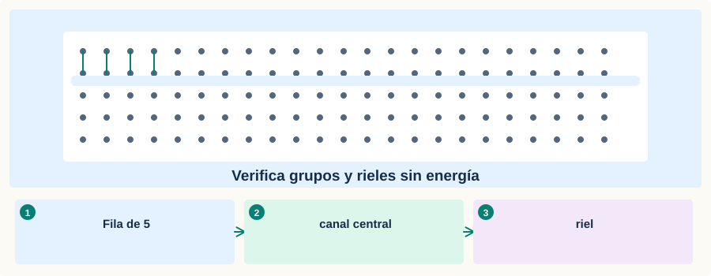

# Práctica guiada · Protoboard y multímetro

**Objetivo:** ¿Por qué un amperímetro en paralelo puede cortocircuitar una pila?

## Procedimiento

Práctica obligatoria supervisada: continuidad en protoboard sin fuente, montaje de 3 V con 330 Ω de 0,25 W, medir V en paralelo y luego I en serie siguiendo manual. Si no hay multímetro adecuado, usar simulación y no aprobar práctica física hasta demostrar seguridad.

1. Formula hipótesis y dibuja el modelo antes de intervenir.
2. Identifica magnitudes que cambian y las que permanecen fijas.
3. Realiza solo el procedimiento seguro descrito; registra resultados y unidades.
4. Compara con predicción; explica diferencias, incertidumbre y limitaciones.

| Ensayo | Condiciones | Predicción | Observación o cálculo | Explicación |
|---|---|---|---|---|
| 1 | | | | |
| 2 | | | | |
| 3 | | | | |

Rúbrica: predicción 25, registro 25, explicación 40, presentación 10. Seguridad obligatoria. En simulación, los resultados calculados no son evidencia experimental independiente.

[Simulador complementario PhET](https://phet.colorado.edu/es/simulations/circuit-construction-kit-dc) · [Plantilla de informe](../../../../../plantillas/informe-laboratorio.pdf) · [PDF](013-laboratorio.pdf) · [← Índice](../README.md)
