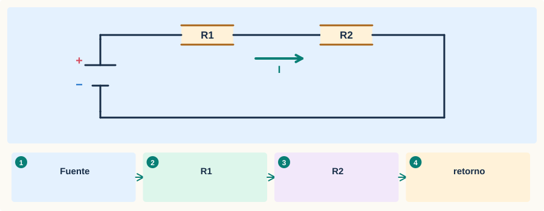
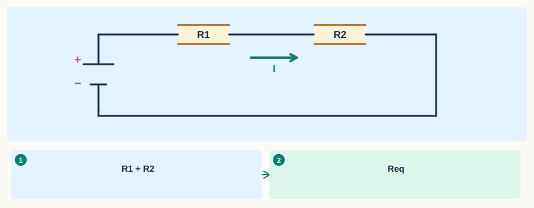
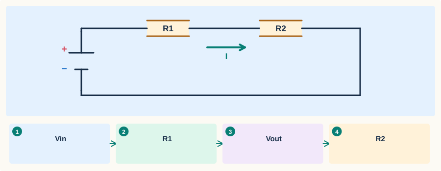
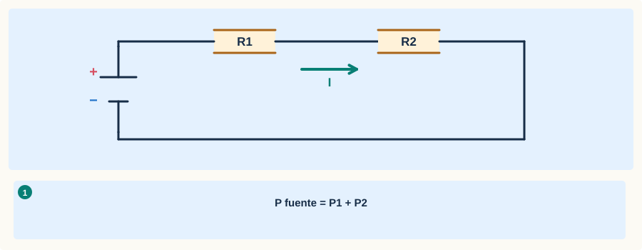
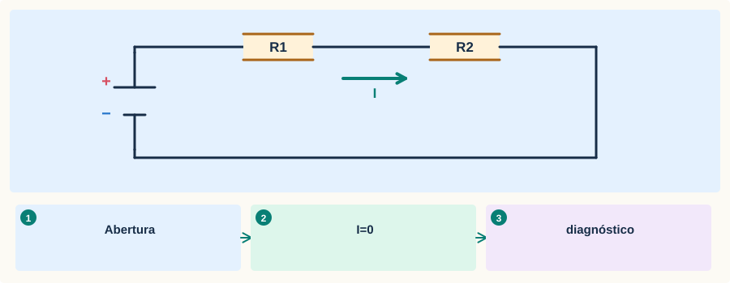

# Cuaderno de ejercicios · Clase 014

[PDF](014-ejercicios.pdf) · [← Índice](../README.md)

## 1. Un único camino

**Ejemplo de estudio:** Una pila, R1 y R2 en un único lazo tienen I1=I2.

**Resuelve:** Si circulan 10 mA por R1, ¿cuánto por R2 en serie?

Escribe datos, procedimiento, unidades (si corresponde), dibujo y justificación. No consultes la solución antes.

## 2. Resistencia equivalente

**Ejemplo de estudio:** 220 Ω +330 Ω =550 Ω.

**Resuelve:** Calcula Req de 100 Ω, 220 Ω y 680 Ω.

Escribe datos, procedimiento, unidades (si corresponde), dibujo y justificación. No consultes la solución antes.

## 3. Corriente total y caídas

**Ejemplo de estudio:** Con 5,5 V, 220 Ω y 330 Ω: I=10 mA, V1=2,2 V, V2=3,3 V.

**Resuelve:** 6 V con 100 Ω y 200 Ω. Calcula I, V1, V2.

Escribe datos, procedimiento, unidades (si corresponde), dibujo y justificación. No consultes la solución antes.

## 4. Divisor de tensión

**Ejemplo de estudio:** 5 V y R1=R2=1 kΩ dan 2,5 V sin carga.

**Resuelve:** 9 V y R1=2 kΩ, R2=1 kΩ. Calcula Vout sin carga.

Escribe datos, procedimiento, unidades (si corresponde), dibujo y justificación. No consultes la solución antes.

## 5. Potencia y balance

**Ejemplo de estudio:** Con I=10 mA, R1=220 y R2=330 Ω: P1=22 mW, P2=33 mW; total 55 mW.

**Resuelve:** I=20 mA en 100 y 200 Ω. Calcula cada P.

Escribe datos, procedimiento, unidades (si corresponde), dibujo y justificación. No consultes la solución antes.

## 6. Fallas y montaje

**Ejemplo de estudio:** Si se abre R2, I=0 en régimen DC ideal y puede aparecer tensión sobre la abertura.

**Resuelve:** ¿Por qué una lámpara en serie puede apagarse si otra se abre?

Escribe datos, procedimiento, unidades (si corresponde), dibujo y justificación. No consultes la solución antes.
