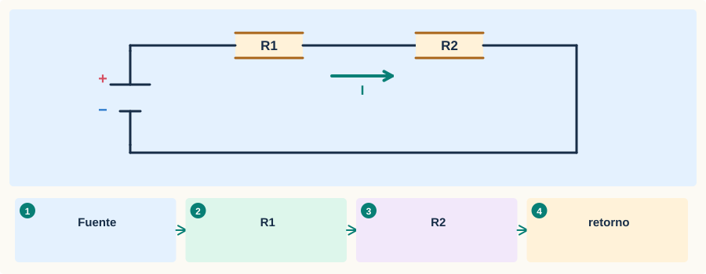
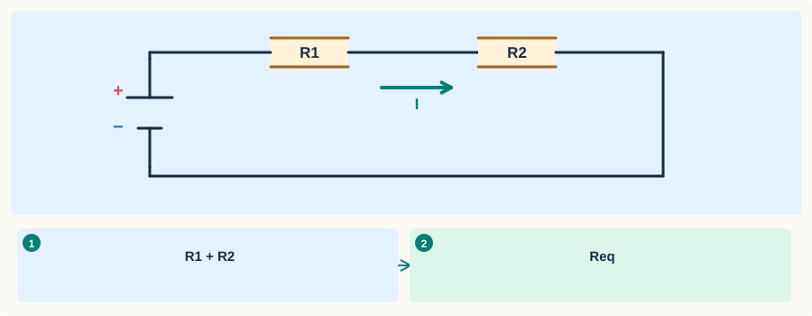
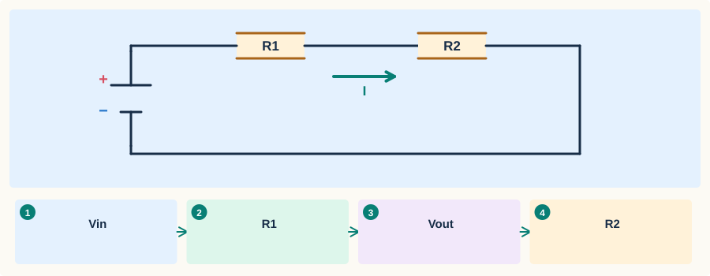
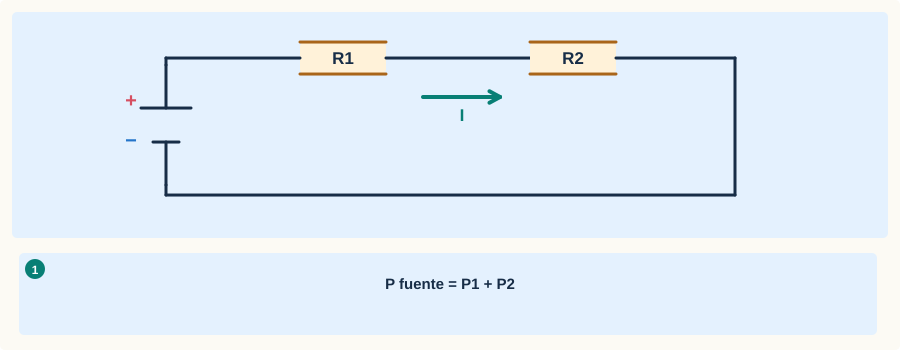
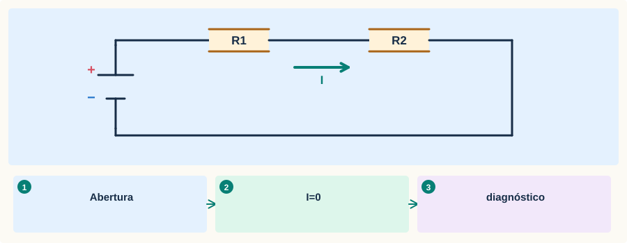

# Circuitos en serie

[← Índice](../README.md)

## 01 · Un único camino

Dos elementos están en serie si comparten un nodo sin otras ramas que transporten corriente. En régimen estacionario la misma corriente atraviesa ambos, porque en el nodo no puede acumularse carga indefinidamente. No depende de la forma del dibujo.

**Ejemplo:** Una pila, R1 y R2 en un único lazo tienen I1=I2.

**Aplica:** Si circulan 10 mA por R1, ¿cuánto por R2 en serie?

---

## 02 · Resistencia equivalente

En una serie de resistores óhmicos, Vtotal=IR1+IR2+…=I(R1+R2+…). Por eso Req=R1+R2+… . El equivalente reproduce la relación tensión-corriente vista desde los terminales, no todos los detalles internos.

**Ejemplo:** 220 Ω +330 Ω =550 Ω.

**Aplica:** Calcula Req de 100 Ω, 220 Ω y 680 Ω.

---

## 03 · Corriente total y caídas

Calcula primero Req, luego I=Vfuente/Req y finalmente Vi=IRi. Una R mayor tiene una caída mayor si comparte corriente. Las caídas no indican pérdida de carga, sino energía transferida por unidad de carga.

**Ejemplo:** Con 5,5 V, 220 Ω y 330 Ω: I=10 mA, V1=2,2 V, V2=3,3 V.

**Aplica:** 6 V con 100 Ω y 200 Ω. Calcula I, V1, V2.

---

## 04 · Divisor de tensión

Para dos resistores en serie sin carga adicional en el nodo intermedio, Vout=Vin R2/(R1+R2), midiendo sobre R2. Si conectamos una carga, queda en paralelo con R2 y cambia la salida. Un divisor no es una fuente ideal de potencia.

**Ejemplo:** 5 V y R1=R2=1 kΩ dan 2,5 V sin carga.

**Aplica:** 9 V y R1=2 kΩ, R2=1 kΩ. Calcula Vout sin carga.

---

## 05 · Potencia y balance

Como I es igual en serie, Pi=I²Ri. La suma de potencias absorbidas debe igualar la potencia entregada por la fuente ideal en estado estacionario. Evalúa potencia nominal de cada resistor antes de montar.

**Ejemplo:** Con I=10 mA, R1=220 y R2=330 Ω: P1=22 mW, P2=33 mW; total 55 mW.

**Aplica:** I=20 mA en 100 y 200 Ω. Calcula cada P.

---

## 06 · Fallas y montaje

Un elemento abierto interrumpe todo el lazo; una conexión accidental que puentea un resistor cambia Req y puede aumentar corriente. No provoques puentes. Verifica continuidad sin energía y mide tensión en paralelo; corriente en serie solo bajo supervisión.

**Ejemplo:** Si se abre R2, I=0 en régimen DC ideal y puede aparecer tensión sobre la abertura.

**Aplica:** ¿Por qué una lámpara en serie puede apagarse si otra se abre?

---
