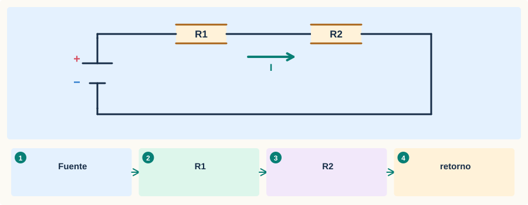

[← Portada](../README.md) · [Índice](../README.md) · [Siguiente →](02.md)

# 01 · Un único camino

*Diagrama didáctico y secuencia conceptual; no a escala.*

## ¿Qué es y por qué ocurre?

Dos elementos están en serie si comparten un nodo sin otras ramas que transporten corriente. En régimen estacionario la misma corriente atraviesa ambos, porque en el nodo no puede acumularse carga indefinidamente. No depende de la forma del dibujo.

## Ejemplo explicado

> Una pila, R1 y R2 en un único lazo tienen I1=I2.

## Ahora tú

Si circulan 10 mA por R1, ¿cuánto por R2 en serie?

[← Portada](../README.md) · [Índice](../README.md) · [Siguiente →](02.md)
