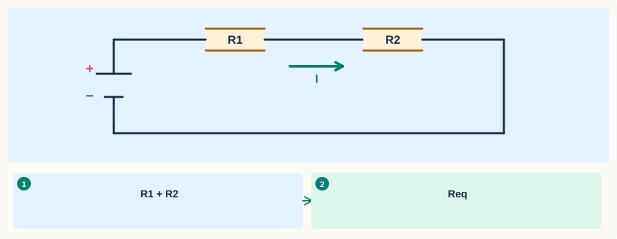
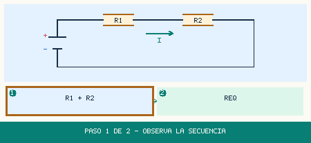

[← Anterior](01.md) · [Índice](../README.md) · [Siguiente →](03.md)

# 02 · Resistencia equivalente

*Diagrama didáctico y secuencia conceptual; no a escala.*

## ¿Qué es y por qué ocurre?

En una serie de resistores óhmicos, Vtotal=IR1+IR2+…=I(R1+R2+…). Por eso Req=R1+R2+… . El equivalente reproduce la relación tensión-corriente vista desde los terminales, no todos los detalles internos.

## Ejemplo explicado

> 220 Ω +330 Ω =550 Ω.

## Ahora tú

Calcula Req de 100 Ω, 220 Ω y 680 Ω.

## Secuencia animada

*Se resaltan etapas del diagrama, no se pretende simular el movimiento físico real.*

[← Anterior](01.md) · [Índice](../README.md) · [Siguiente →](03.md)
