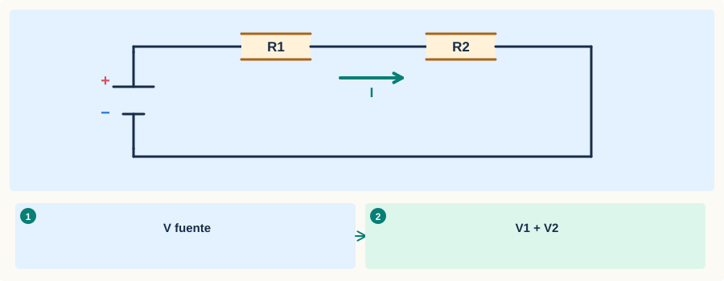

[← Anterior](02.md) · [Índice](../README.md) · [Siguiente →](04.md)

# 03 · Corriente total y caídas

*Diagrama didáctico y secuencia conceptual; no a escala.*

## ¿Qué es y por qué ocurre?

Calcula primero Req, luego I=Vfuente/Req y finalmente Vi=IRi. Una R mayor tiene una caída mayor si comparte corriente. Las caídas no indican pérdida de carga, sino energía transferida por unidad de carga.

## Ejemplo explicado

> Con 5,5 V, 220 Ω y 330 Ω: I=10 mA, V1=2,2 V, V2=3,3 V.

## Ahora tú

6 V con 100 Ω y 200 Ω. Calcula I, V1, V2.

[← Anterior](02.md) · [Índice](../README.md) · [Siguiente →](04.md)
