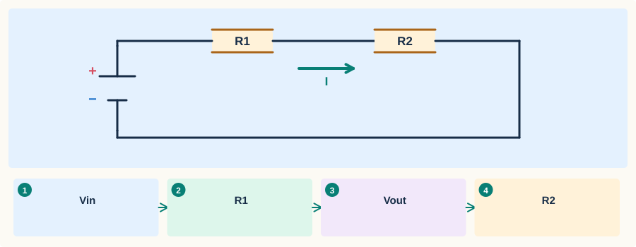

[← Anterior](03.md) · [Índice](../README.md) · [Siguiente →](05.md)

# 04 · Divisor de tensión

*Diagrama didáctico y secuencia conceptual; no a escala.*

## ¿Qué es y por qué ocurre?

Para dos resistores en serie sin carga adicional en el nodo intermedio, Vout=Vin R2/(R1+R2), midiendo sobre R2. Si conectamos una carga, queda en paralelo con R2 y cambia la salida. Un divisor no es una fuente ideal de potencia.

## Ejemplo explicado

> 5 V y R1=R2=1 kΩ dan 2,5 V sin carga.

## Ahora tú

9 V y R1=2 kΩ, R2=1 kΩ. Calcula Vout sin carga.

[← Anterior](03.md) · [Índice](../README.md) · [Siguiente →](05.md)
