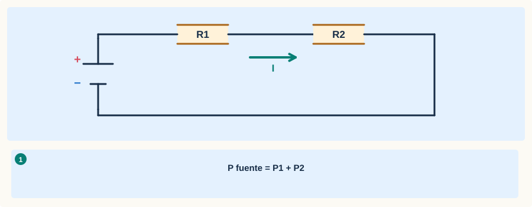

[← Anterior](04.md) · [Índice](../README.md) · [Siguiente →](06.md)

# 05 · Potencia y balance

*Diagrama didáctico y secuencia conceptual; no a escala.*

## ¿Qué es y por qué ocurre?

Como I es igual en serie, Pi=I²Ri. La suma de potencias absorbidas debe igualar la potencia entregada por la fuente ideal en estado estacionario. Evalúa potencia nominal de cada resistor antes de montar.

## Ejemplo explicado

> Con I=10 mA, R1=220 y R2=330 Ω: P1=22 mW, P2=33 mW; total 55 mW.

## Ahora tú

I=20 mA en 100 y 200 Ω. Calcula cada P.

[← Anterior](04.md) · [Índice](../README.md) · [Siguiente →](06.md)
