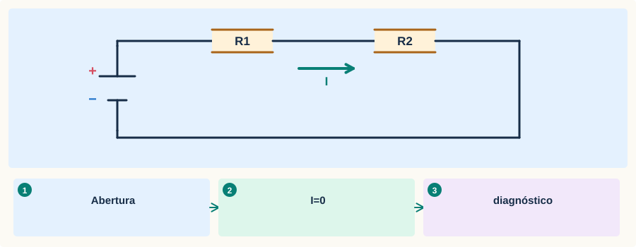

[← Anterior](05.md) · [Índice](../README.md) · [Actividades y cierre →](../descargas.md)

# 06 · Fallas y montaje

*Diagrama didáctico y secuencia conceptual; no a escala.*

## ¿Qué es y por qué ocurre?

Un elemento abierto interrumpe todo el lazo; una conexión accidental que puentea un resistor cambia Req y puede aumentar corriente. No provoques puentes. Verifica continuidad sin energía y mide tensión en paralelo; corriente en serie solo bajo supervisión.

## Ejemplo explicado

> Si se abre R2, I=0 en régimen DC ideal y puede aparecer tensión sobre la abertura.

## Ahora tú

¿Por qué una lámpara en serie puede apagarse si otra se abre?

[← Anterior](05.md) · [Índice](../README.md) · [Actividades y cierre →](../descargas.md)
