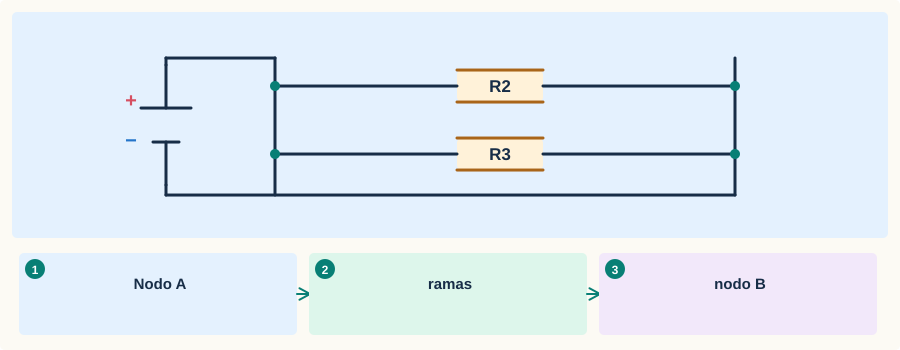
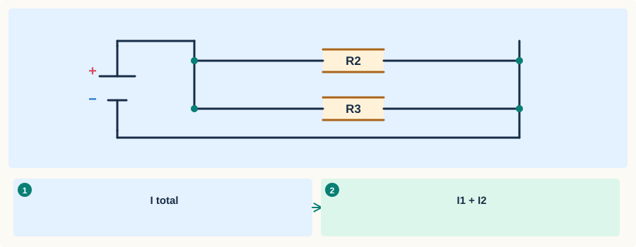
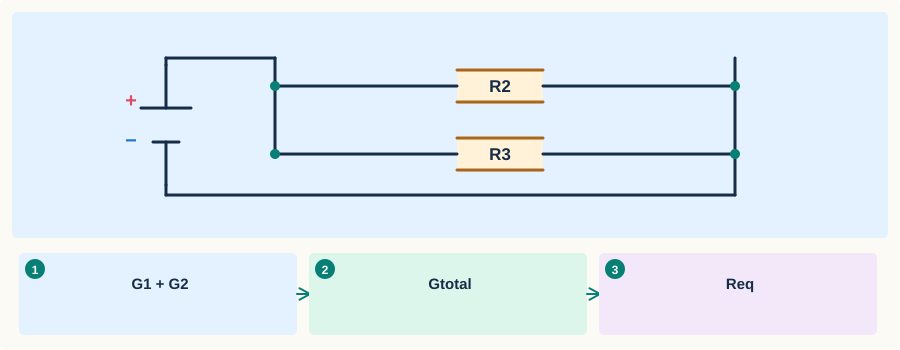
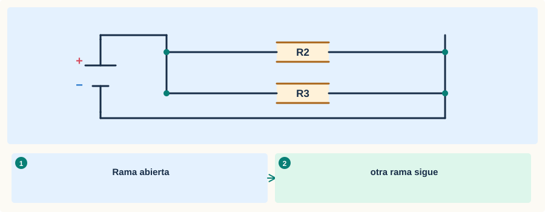
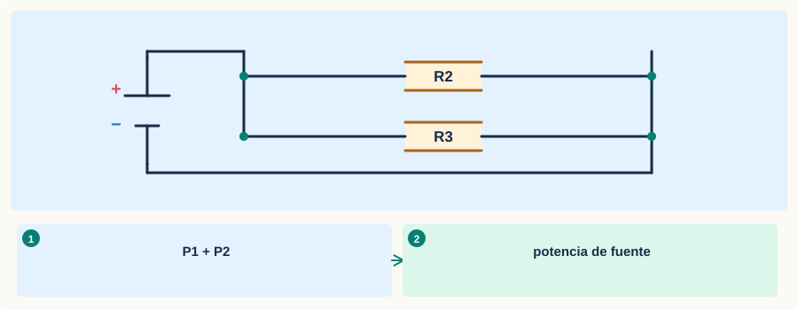
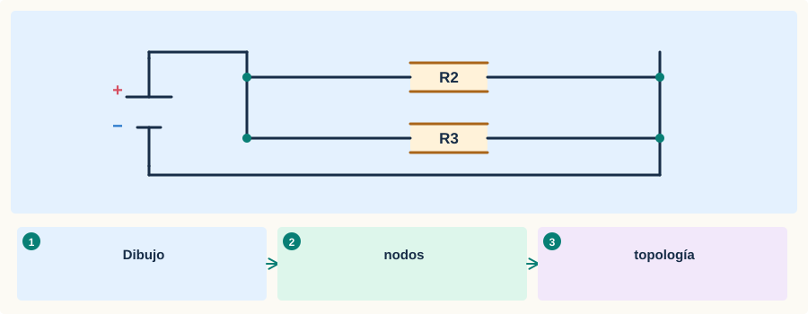

# Cuaderno de ejercicios · Clase 015

[PDF](015-ejercicios.pdf) · [← Índice](../README.md)

## 1. Dos nodos comunes

**Ejemplo de estudio:** Una fuente de 3 V conectada a dos resistores paralelos aplica 3 V a cada uno.

**Resuelve:** Si V1=5 V, ¿V2 en paralelo ideal?

Escribe datos, procedimiento, unidades (si corresponde), dibujo y justificación. No consultes la solución antes.

## 2. Corriente por rama

**Ejemplo de estudio:** 3 V sobre 300 Ω y 600 Ω: I1=10 mA, I2=5 mA; total 15 mA.

**Resuelve:** 6 V sobre 1 kΩ y 2 kΩ. Calcula ambas I y total.

Escribe datos, procedimiento, unidades (si corresponde), dibujo y justificación. No consultes la solución antes.

## 3. Resistencia equivalente y conductancia

**Ejemplo de estudio:** 300 Ω ||600 Ω =200 Ω, menor que 300 Ω.

**Resuelve:** Calcula 100 Ω ||100 Ω ||100 Ω.

Escribe datos, procedimiento, unidades (si corresponde), dibujo y justificación. No consultes la solución antes.

## 4. Reparto y casos límite

**Ejemplo de estudio:** Con dos ramas iguales se reparte It por mitad.

**Resuelve:** Si una de dos ramas iguales se abre, ¿qué sucede con la otra bajo fuente ideal fija?

Escribe datos, procedimiento, unidades (si corresponde), dibujo y justificación. No consultes la solución antes.

## 5. Potencia en paralelo

**Ejemplo de estudio:** 3 V sobre 300 y 600 Ω: P1=30 mW, P2=15 mW, total 45 mW.

**Resuelve:** 5 V sobre 1 kΩ y 2 kΩ: P total.

Escribe datos, procedimiento, unidades (si corresponde), dibujo y justificación. No consultes la solución antes.

## 6. Aplicaciones y diagnóstico

**Ejemplo de estudio:** Dos luces en paralelo ideal: si una se abre, la otra puede mantenerse encendida.

**Resuelve:** ¿Por qué no basta ver dos componentes lado a lado para concluir que están en paralelo?

Escribe datos, procedimiento, unidades (si corresponde), dibujo y justificación. No consultes la solución antes.
