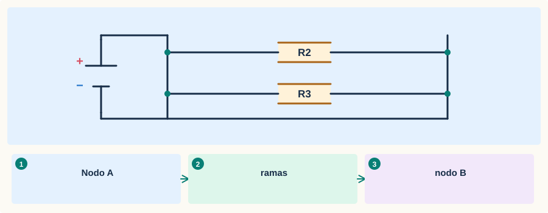
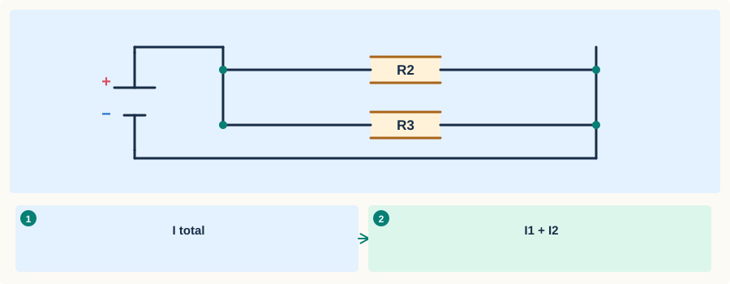
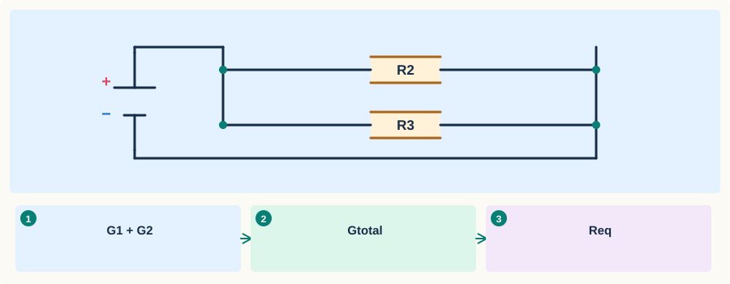
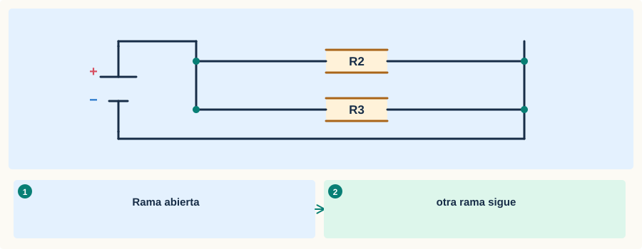
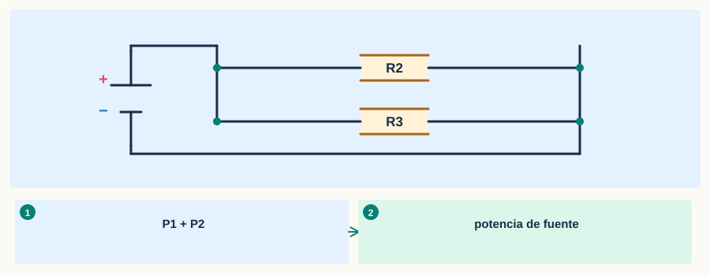
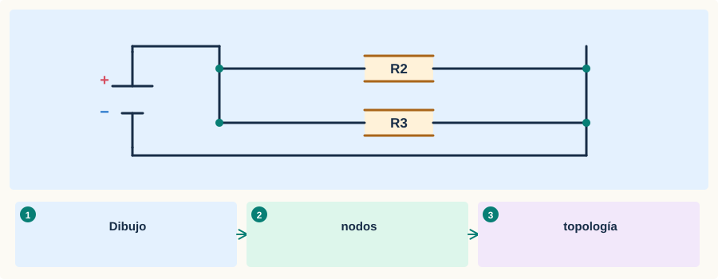

# Circuitos en paralelo

[← Índice](../README.md)

## 01 · Dos nodos comunes

Elementos en paralelo comparten ambos nodos terminales. En el modelo de conductor ideal tienen la misma diferencia de potencial. La corriente puede repartirse entre ramas; los valores no tienen que ser iguales.

**Ejemplo:** Una fuente de 3 V conectada a dos resistores paralelos aplica 3 V a cada uno.

**Aplica:** Si V1=5 V, ¿V2 en paralelo ideal?

---

## 02 · Corriente por rama

Usa I1=V/R1 e I2=V/R2. Si una rama tiene menor resistencia, conduce más corriente para la misma tensión. La fuente ideal entrega la suma de corrientes de las ramas.

**Ejemplo:** 3 V sobre 300 Ω y 600 Ω: I1=10 mA, I2=5 mA; total 15 mA.

**Aplica:** 6 V sobre 1 kΩ y 2 kΩ. Calcula ambas I y total.

---

## 03 · Resistencia equivalente y conductancia

De Itotal=V/R1+V/R2 se obtiene 1/Req=1/R1+1/R2. La conductancia G=1/R se mide en siemens (S). Agregar una rama resistiva positiva aumenta conductancia total, por tanto disminuye Req. Para dos: Req=R1R2/(R1+R2).

**Ejemplo:** 300 Ω ||600 Ω =200 Ω, menor que 300 Ω.

**Aplica:** Calcula 100 Ω ||100 Ω ||100 Ω.

---

## 04 · Reparto y casos límite

Para dos ramas, I1=It R2/(R1+R2) si solo existen esas dos y son óhmicas. Una rama abierta equivale idealmente a resistencia infinita; su corriente es cero, pero las demás pueden seguir funcionando. Una rama de resistencia muy baja puede sobrecargar la fuente: no se prueba físicamente.

**Ejemplo:** Con dos ramas iguales se reparte It por mitad.

**Aplica:** Si una de dos ramas iguales se abre, ¿qué sucede con la otra bajo fuente ideal fija?

---

## 05 · Potencia en paralelo

Con tensión común, Pi=V²/Ri. La rama de menor R disipa más potencia si V se mantiene. La suma de potencias es VIt. Una fuente real puede reducir tensión o limitar corriente cuando se agregan cargas.

**Ejemplo:** 3 V sobre 300 y 600 Ω: P1=30 mW, P2=15 mW, total 45 mW.

**Aplica:** 5 V sobre 1 kΩ y 2 kΩ: P total.

---

## 06 · Aplicaciones y diagnóstico

En placas y sistemas de alimentación, varias cargas suelen compartir líneas de suministro para funcionar independientemente; no todas se comportan como resistores. Una rama abierta puede dejar otras activas. Para diagnóstico, identifica nodos, compara tensiones y predice corrientes antes de medir.

**Ejemplo:** Dos luces en paralelo ideal: si una se abre, la otra puede mantenerse encendida.

**Aplica:** ¿Por qué no basta ver dos componentes lado a lado para concluir que están en paralelo?

---
